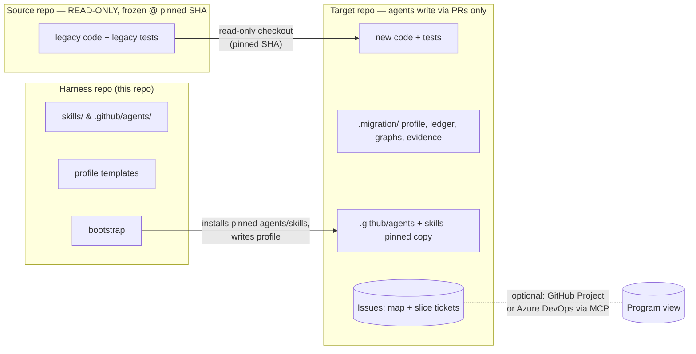
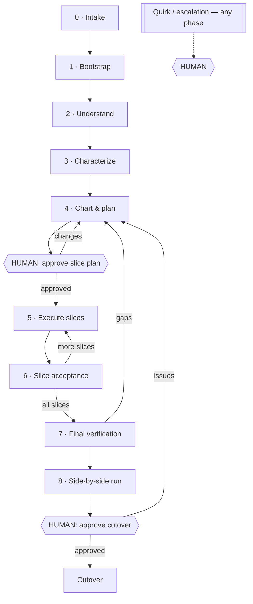
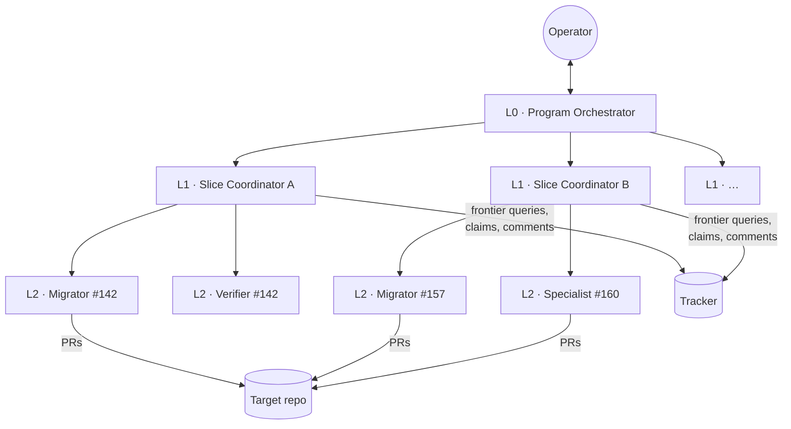

# AI Factory Swarm — Architecture

> Status: **Draft v0.1** (2026-10-30). Baseline: the `migrating-java-to-django` skill and its
> role agents in [code-migration-hackathon PR #6](https://github.com/martins-vds/code-migration-hackathon/pull/6).
> This document generalizes that work into a language-agnostic, multi-agent harness that scales to
> codebases of any size. Key decisions are recorded as ADRs in [`docs/adr/`](adr/); terms are
> defined in [`GLOSSARY.md`](../GLOSSARY.md).

## Contents

1. [Purpose and the fidelity contract](#1-purpose-and-the-fidelity-contract)
2. [Decisions at a glance](#2-decisions-at-a-glance)
3. [Repository topology](#3-repository-topology)
4. [Agent roles](#4-agent-roles)
5. [Lifecycle](#5-lifecycle)
6. [The migration profile](#6-the-migration-profile)
7. [The fidelity ledger](#7-the-fidelity-ledger)
8. [Verification model](#8-verification-model)
9. [Work tracking](#9-work-tracking)
10. [Orchestration and scaling](#10-orchestration-and-scaling)
11. [Human in the loop](#11-human-in-the-loop)
12. [What carries over from PR #6](#12-what-carries-over-from-pr-6)
13. [Open questions and next steps](#13-open-questions-and-next-steps)

---

## 1. Purpose and the fidelity contract

AI Factory Swarm is a fleet of agents that rewrites an application from one stack to another
(language A → language B, or language A → a newer version of A) with **high fidelity**: the new
application does what the old one does.

Every agent carries this contract in context at all times:

> **Preserve observable behavior. Re-architect freely behind it. Surface every quirk to a human.**

- **Observable behavior** is anything visible from outside the application: API requests and
  responses, UI screens, flows and states, data written to stores, messages published, files
  produced, calls to external systems, scheduled-job effects, error responses and security
  decisions (who may do what). This is the **equivalence boundary** ([ADR-0001](adr/0001-behavioral-equivalence-at-observable-boundaries.md)).
- **Behind the boundary**, the target is idiomatic for the new stack and follows modern design:
  domain-driven design, clean architecture, dependency injection, clean code and appropriate design
  patterns. Structural similarity to the source is *not* a goal.
- **Quirks and bugs** discovered in the source (odd edge cases, apparent defects, undefined behavior)
  are never silently preserved and never silently fixed. They are raised to a human **at the moment
  of discovery** ([ADR-0007](adr/0007-quirks-escalate-immediately.md)).
- **Lose nothing silently.** Every capability of the source is migrated or explicitly documented as
  deferred / replaced / dropped, with a human-approved justification.

**Definition of done:** a target application, running side by side with the legacy application on a
copy of production data, that test users have verified, and that a human has approved for cutover.

---

## 2. Decisions at a glance

| # | Decision | ADR |
|---|----------|-----|
| 1 | Equivalence is judged at observable boundaries; internals may be fully re-architected | [0001](adr/0001-behavioral-equivalence-at-observable-boundaries.md) |
| 2 | Three repositories: harness, source (read-only, frozen, pinned), target | [0002](adr/0002-three-repository-topology.md) |
| 3 | Matt Pocock's skills are the planning/execution spine | [0003](adr/0003-mattpocock-skills-as-spine.md) |
| 4 | Two-level tracking (decision map + slice tickets) in the target repo; Azure DevOps via MCP | [0004](adr/0004-two-level-tracking-in-target-repo.md) |
| 5 | Characterization tests are mandatory before migration; "verified by review" is the human-signed fallback | [0005](adr/0005-characterization-first.md) |
| 6 | Incremental build, single cutover, after a side-by-side run on a production-data copy | [0006](adr/0006-side-by-side-then-cutover.md) |
| 7 | Quirks escalate immediately as blocking question tickets assigned to a human | [0007](adr/0007-quirks-escalate-immediately.md) |
| 8 | Layered orchestration; workers may run locally or remotely | [0008](adr/0008-layered-orchestration.md) |
| 9 | Source graphs come from a third-party tool, behind an adapter | [0009](adr/0009-third-party-code-graph.md) |

---

## 3. Repository topology



| Repo | Purpose | Agent access |
|------|---------|--------------|
| **Harness** | Generic role agents, harness skills, profile templates, bootstrap logic. Versioned and released. | Read. Changed only by humans. |
| **Source** | The legacy application and its tests. | **Read-only, enforced by credentials** (read-only token / deploy key), not by instruction. Frozen for the life of the migration and **pinned to a commit SHA** so graphs and characterization results are reproducible. |
| **Target** | The new application. Also holds all migration state: the profile, the fidelity ledger, graph snapshots, evidence and the issue tracker. | Write, **only through pull requests**. `main` is protected; merges need human approval. |

Why migration state lives in the target repo: PRs close their tickets natively, the history of *why*
the new code looks the way it does travels with the code, and remote agents (which run in the
target repo's context) find everything they need without extra credentials.

**Target repo layout (proposed):**

```
/
├── GLOSSARY.md                   # domain language (domain-modeling skill)
├── docs/adr/                     # target-architecture decisions
├── docs/agents/                  # tracker + domain config (setup-matt-pocock-skills)
├── .github/agents/               # role agents, copied from harness at a pinned version
├── .agents/skills/               # skills resolved by the migration profile
├── .migration/
│   ├── profile.yaml              # the migration profile (§6)
│   ├── source.lock               # source repo URL + pinned SHA
│   ├── ledger/                   # fidelity ledger, one file per capability (§7)
│   ├── graphs/source/            # source graph snapshot(s)
│   ├── graphs/target/            # target graph snapshots, per slice
│   ├── characterization/         # harness + recorded golden behavior from the source
│   └── evidence/                 # per-slice gate reports
└── src/ …                        # the new application
```

---

## 4. Agent roles

Roles evolve from PR #6's seven agents. New roles are marked ★.

| Role | Layer | Responsibility | Writes | Key skills |
|------|-------|----------------|--------|------------|
| **Program Orchestrator** | L0 | Intake; owns the map, the slice plan, the human gates, escalations, cutover readiness. Dispatches slice coordinators. Never writes application code. | Tracker, `.migration/` (via PR) | `wayfinder`, `to-tickets`, `grilling` |
| ★ **Bootstrapper** | L0 | Detects stacks, builds the migration profile, installs pinned skills/agents into the target, configures the tracker, scaffolds the target per architecture ADRs. | Target repo (setup PR) | `setup-matt-pocock-skills`, `find-skills`, `codebase-design` |
| **Analyst** | L1 | Generates the source graph, enumerates capabilities (structural, behavioral, UI, integrations), seeds the ledger, flags quirk candidates. | Ledger, graph snapshot | graph adapter, `domain-modeling`, `research` |
| ★ **Characterizer** | L1 | Builds a harness around the source and records its observable behavior as characterization tests; inventories legacy tests and the behavior they assert. Marks capabilities that cannot be characterized as `review-only`. | `.migration/characterization/`, ledger | `tdd`, source-language test skills |
| **Planner** | L1 | Drafts vertical slices from the graph + ledger, with dependency edges and sizing. | Draft slice plan | `to-tickets`, `codebase-design` |
| ★ **Slice Coordinator** | L1 | Owns one slice end to end: sequences its tickets on the frontier, dispatches workers, runs slice acceptance (§8), keeps the ledger in sync. | Tracker comments, evidence | `implement`, `code-review` |
| **Migrator** | L2 | Implements exactly one ticket test-first in the target. One per ticket; many in parallel. | Target code (one PR per ticket) | `tdd`, `implement`, target-stack skills from profile |
| **Specialist Migrator** | L2 | Profile-defined specialists: data/schema migration, UI, messaging, etc. (PR #6's DB Migrator becomes one of these.) | Target code | specialist skills from profile |
| **Verifier** | L2 | Fresh context, no builder reasoning. Runs gates 1–3 and 5 on a ticket's PR; closes coverage gaps with tests; reports, never fixes production code. | Tests, evidence | `tdd`, `diagnosing-bugs` |
| **Auditor** | L1 / L0 | Read-only, first-principles. Per slice: capability-coverage check (gate 4). Final: full bidirectional audit and the A–G report. Ignores progress labels. | Evidence report | graph adapter, `code-review` |

Rules carried over from PR #6 and kept binding:

- **Artifacts, not conversation.** Every hand-off passes paths/ids (ticket, profile, ledger,
  graph), never chat history.
- **Independent verification.** Verifier and Auditor never receive the builder's reasoning.
- **Verify, don't trust.** A coordinator re-reads the evidence (fresh command output) before
  accepting "done".
- **Stop rules.** Same failure after two honest attempts, a real limit, or a graph discrepancy →
  stop and escalate.
- **No hidden state.** Discovered work, reorderings and deferrals are written to the tracker or
  ledger immediately.
- **Graph first.** Query the graph before reading source files; correct the graph when it is wrong.

---

## 5. Lifecycle



### Phase 0 — Intake (Program Orchestrator)
Record: source repo URL and **pinned SHA**, target repo, target stack and version, tracker choice,
data-store details. Nothing proceeds until all are known. Write `.migration/source.lock`.

### Phase 1 — Bootstrap (Bootstrapper)
1. Detect source stacks (languages, frameworks, build tools, data stores, UI tech, integrations)
   from the build files and a first pass of the graph.
2. Resolve skills into the **migration profile** (§6): source-stack, target-stack, specialist and
   universal skills. Find gaps with `find-skills`; a gap with no available skill is escalated, not
   improvised.
3. Run `setup-matt-pocock-skills` against the target repo (tracker, labels, domain-doc layout).
4. Copy pinned role agents and skills into the target repo.
5. Scaffold the target (layout, CI, lint/format, test runner, container setup) following the
   target-architecture ADRs. Delivered as one **setup PR**, which a human merges.

### Phase 2 — Understand (Analyst)
Generate the source graph through the graph adapter ([ADR-0009](adr/0009-third-party-code-graph.md)),
always, regardless of size. Enumerate every capability into the ledger: structural (from the graph),
behavioral (side effects, error handling, config-driven branches, edge cases), **UI** (screens, flows,
forms, states, bindings) and **integrations** (every external system). Ignore existing
migration/porting docs; use understanding docs only, and never let docs outrank code. Quirk
candidates found here are escalated immediately (§11).

### Phase 3 — Characterize (Characterizer)
Mandatory, before any migration ([ADR-0005](adr/0005-characterization-first.md)):
1. **Inventory legacy tests.** For each, record the behavior it asserts as ledger evidence. That
   behavior must reappear as a test in the target, in the target's own idiom.
2. **Characterize at the equivalence boundary.** Build a harness that drives the source through its
   external interfaces (HTTP, UI, CLI, queue, batch input, DB state) and records inputs → observable
   outputs, covering normal, empty/null/zero and boundary cases.
3. **Fallback.** Where a capability cannot reasonably be characterized (no runnable environment,
   hardware/third-party dependency, non-deterministic behavior), mark it `review-only` in the ledger.
   It will need a human tester's sign-off before cutover.

### Phase 4 — Chart & plan (Program Orchestrator + Planner)
1. **Chart the decision map** with `wayfinder`: target architecture and bounded contexts, library and
   idiom mappings, data/schema strategy, cross-cutting concerns (auth, logging, config). Decisions
   land as ADRs and glossary entries in the target repo.
2. **Draft slices.** The Planner walks the graph and ledger to propose **vertical slices**: each a
   narrow but complete path through every layer, anchored on an observable entry point (endpoint, UI
   flow, job), testable end to end against its characterization tests. Dependencies come from graph
   edges; shared foundations (domain model, persistence, auth) come first as prefactoring slices.
3. Every ledger capability maps to a slice or to an explicit, justified deferral.
4. **Human gate:** the operator approves the slice plan. Then `to-tickets` publishes it (§9).

### Phase 5 — Execute (Slice Coordinators → Migrators/Verifiers)
For each ticket on the frontier:
1. Coordinator claims and dispatches a Migrator with ticket id + profile + ledger paths.
2. Migrator: resolve dependencies from the graph → write failing target tests from the ticket's
   characterization cases → implement idiomatically → refactor → run gates 1–3 → open a PR that
   closes the ticket and updates its ledger entries.
3. Verifier (fresh context) runs gates on the PR and adds tests where coverage is thin.
4. **Human gate:** PR review and merge.
5. Anything discovered out of scope becomes a new ticket; any quirk becomes a question ticket (§11).

### Phase 6 — Slice acceptance (Slice Coordinator + Auditor)
When every ticket in a slice is merged: run the slice's end-to-end characterization suite against the
target, regenerate the target graph for the slice's components, run the capability-coverage check
(gate 4) and reconcile the ledger. Evidence goes to `.migration/evidence/<slice>/`. Gaps reopen work.

### Phase 7 — Final verification (Auditor)
Carried over from PR #6's final-verification pass: refresh both graphs, verify **top-down** from every
screen/route/workflow and **bottom-up** from every non-UI capability (jobs, integrations, handlers,
security/recovery paths), ignore progress labels and re-prove from code + graphs + tests, and emit the
structured **A–G report**. Unresolved gaps block Phase 8.

### Phase 8 — Side-by-side run and cutover ([ADR-0006](adr/0006-side-by-side-then-cutover.md))
1. Deploy the target alongside the running legacy application, on a **copy of the production
   database** (transformed into the target schema where the data model changed).
2. Test users exercise both applications. Every `review-only` capability gets a human-tester ticket.
3. Discrepancies come back in as tickets (bug or quirk) and loop through Phase 4/5.
4. **Human gate:** cutover approval. The legacy application stays available until the cutover is
   accepted, which is the rollback path.

---

## 6. The migration profile

The profile replaces PR #6's hard-coded orchestration map. It is the single place where anything
stack-specific lives; every role agent reads it, and none of them name a language.

```yaml
# .migration/profile.yaml (illustrative)
harness_version: 0.1.0
source:
  repo: org/legacy-app
  sha: 3f9c2e1…
  stacks: [java-17, spring-boot-2, jsf, oracle-19c, mybatis]
target:
  repo: org/new-app
  stacks: [python-3.13, django-5, postgresql-17]
  architecture:
    style: clean-architecture
    adrs: [docs/adr/0001-bounded-contexts.md, docs/adr/0002-di-container.md]
graph:
  tool: understand-anything          # adapter id (ADR-0009)
  source_snapshot: .migration/graphs/source/
skills:                              # capability → skill(s), resolved at bootstrap
  universal:
    planning: [wayfinder, to-tickets, grilling, domain-modeling]
    design: [codebase-design, improve-codebase-architecture]
    build: [tdd, implement]
    review: [code-review, pr]
    debugging: [diagnosing-bugs]
    research: [research]
  source:
    read: [java-docs]
    characterize: [java-junit]
  target:
    patterns: [django-patterns]
    security: [django-security]
    async: [django-celery]
    verify: [django-verification, pytest-coverage]
  specialists:
    data: [reviewing-oracle-to-postgres-migration, migrating-oracle-to-postgres-stored-procedures]
    ui: [agent-browser]
    runtime: [docker-expert, docker-compose-orchestration]
gates:                               # concrete commands per gate (§8)
  build: ["python -m compileall src", "python manage.py check"]
  idiom: ["ruff check", "ruff format --check"]
  tests: ["pytest -q"]
translation_rules: .migration/translation-rules.md   # idiom + library mapping, from map decisions
```

---

## 7. The fidelity ledger

The ledger is the inventory of every source capability and its fate. In PR #6 it is a markdown
table; at scale it becomes **structured data, one file per capability** under `.migration/ledger/`,
so many agents can update it in parallel PRs without conflicts, and it can be queried.

```yaml
# .migration/ledger/billing.invoice.charge-rounding.yaml
id: billing.invoice.charge-rounding
kind: behavioral            # structural | behavioral | ui | integration
source:
  graph_node: com.acme.billing.InvoiceService#charge
  location: billing/src/main/java/com/acme/billing/InvoiceService.java
boundary: "POST /invoices/{id}/charge → response body, invoice.amount_charged"
slice: billing-charge-invoice
tickets: [org/new-app#142]
target:
  components: [billing.application.charge_invoice, billing.domain.Money]
status: migrated            # pending | in-progress | migrated | deferred | replaced | dropped
verification: characterized # characterized | legacy-test | review-only
evidence:
  - .migration/characterization/billing/charge_rounding.json
  - tests/billing/test_charge_invoice.py::test_half_even_rounding
quirks: [org/new-app#150]   # linked question tickets, if any
approval: null              # required for deferred | replaced | dropped | review-only
```

Rules:
- `deferred`, `replaced` and `dropped` require a justification and a human approval reference.
- `review-only` requires a human-tester sign-off ticket before cutover.
- Ledger changes ride in the same PR as the code that justifies them.

---

## 8. Verification model

### 8.1 Evidence ladder
Strongest to weakest. Each capability records which rung it reached.

1. **Side-by-side observation** — same inputs to legacy and target on copies of production data;
   outputs compared (Phase 8).
2. **Characterization tests** — recorded source behavior replayed against the target.
3. **Transcribed legacy tests** — behavior the legacy suite asserted, re-expressed in the target.
4. **Graph capability coverage** — every source capability maps to target components *and* to at
   least one passing test.
5. **Review only** — human review and exploratory testing; requires sign-off.

### 8.2 Why graph comparison becomes capability coverage
With freedom to re-architect, a node-for-node diff of source and target graphs is mostly noise. Gate
4 therefore asks a narrower, provable question: *does every capability in the source graph and ledger
have (a) a target counterpart and (b) passing evidence at the equivalence boundary?* PR #6's five gap
classes still apply, reinterpreted at the boundary: missing capability, misplaced responsibility
(violates target ADRs), broken flow (an end-to-end path that no longer connects), missing integration,
and untested path.

### 8.3 Gates
| Gate | Question | Runs | Command source |
|------|----------|------|----------------|
| 1 · Build | Does it compile/load/configure cleanly? | every PR | `profile.gates.build` |
| 2 · Behavior | Do characterization + transcribed legacy tests pass at the boundary? | every PR | `profile.gates.tests` |
| 3 · Idiom & architecture | Idiomatic for the target stack; conforms to target ADRs (layers, DI, domain boundaries)? | every PR | `profile.gates.idiom` + `code-review` |
| 4 · Capability coverage | Every capability in scope accounted for and evidenced? | per slice, and final | Auditor |
| 5 · Regression | Full suite still green; earlier slices unaffected? | every PR (CI) | `profile.gates.tests` |

A gate is passed only on fresh command output from the current step.

---

## 9. Work tracking

Two levels are enough ([ADR-0004](adr/0004-two-level-tracking-in-target-repo.md)); the goal is a
working application, not a particular hierarchy.

| Level | What it holds | Created by | Shape on GitHub |
|-------|---------------|------------|-----------------|
| **Decision map** | Open questions that shape the work: architecture, mappings, data strategy, **quirk rulings** | `wayfinder` | One issue labelled `wayfinder:map`; decision tickets as sub-issues, `wayfinder:<type>` labels |
| **Slice tickets** | Build work: one vertical slice or a sub-slice sized for one agent session, with acceptance criteria drawn from the ledger | `to-tickets` | Issues labelled `ready-for-agent`, grouped under a slice parent issue via sub-issues; native blocking edges |

- **Frontier:** open, unblocked, unclaimed tickets. Coordinators pull only from the frontier.
- **Claim:** assign before any work, so concurrent agents skip it.
- **Decisions block builds.** A quirk or mapping question blocks only the tickets it affects (native
  blocking edge); everything else proceeds.
- **Sizing:** a slice ticket fits one fresh agent context. Larger slices are split by `to-tickets`;
  wide mechanical changes use expand → migrate-in-batches → contract.
- **Program view:** an organization-level GitHub Project can aggregate across repos if useful.
- **Azure DevOps:** the same operations (create, sub-item, block, claim, comment, close, frontier
  query) are expressed in a tracker doc backed by the Azure DevOps MCP server, via
  `setup-matt-pocock-skills`' "Other" tracker option. Roles never call a tracker directly; they follow
  the tracker doc.

---

## 10. Orchestration and scaling



**Scaling principle:** no agent holds the whole migration in its context. State lives in the tracker
and `.migration/`; each agent loads only the low-resolution view it needs (the map, its slice, its
ticket) and zooms into the graph on demand.

**Dispatch.** A coordinator dispatches a worker through a **dispatch adapter**, so the same role
definition can run:
- **locally**, as a subagent of the coordinator's session (e.g. a custom agent in VS Code / Copilot
  CLI), or
- **remotely**, by handing a ticket to a cloud agent working in the target repo (e.g. assigning the
  issue to the Copilot coding agent, or a workflow that runs an agent CLI), which reports back via
  the PR and ticket.

Remote workers run in the target repo's context, so the target carries the pinned agents and skills
(Phase 1) and gets a **read-only checkout of the source at the pinned SHA** in its setup steps.

**Concurrency rules.**
- Parallelize only tickets with no dependency edge between them and no shared files.
- One PR per ticket; ledger files are per capability, so parallel PRs rarely conflict.
- Every operation is idempotent and resumable: an agent that dies leaves a claimed ticket and
  possibly a draft PR, and a coordinator can re-dispatch from the ticket alone.
- Concurrency limits (number of parallel workers, remote vs local mix) are profile settings, set by
  the operator, never inferred by agents.

---

## 11. Human in the loop

| Gate / event | Who | Blocks |
|--------------|-----|--------|
| Setup PR (bootstrap) | Operator | All later phases |
| Slice plan approval | Operator | Execution |
| Each PR merge | Reviewer | That ticket |
| Quirk / bug in source | Any human; they may consult a domain expert | Only dependent tickets |
| Deferral / replacement / drop of a capability | Any human | That capability's closure |
| Stop-rule escalation (repeated failure, real limit, graph discrepancy) | Operator | That ticket or slice |
| `review-only` sign-off | Human tester | Cutover |
| Cutover | Operator / business owner | Go-live |

**Quirk ticket (decision-map ticket, `wayfinder:grilling`), raised the moment a quirk is found:**

```markdown
## Question
<What the source does, in one sentence.> Preserve, fix, or something else?

## Evidence
- Source: <graph node / file:line at pinned SHA>
- Characterization: <recorded input → output>
- Why it looks wrong: <expected vs actual>

## Impact
- Ledger capabilities: <ids>
- Blocks: <ticket links>

## Options
1. Preserve exactly (target reproduces the quirk; test pins it)
2. Fix (target diverges; divergence documented in ledger)
3. Other
```

The agent never answers its own question. The human who receives it decides whether to involve a
domain expert. The resolution is recorded on the ticket and in the affected ledger entries.

---

## 12. What carries over from PR #6

| PR #6 (Java → Django) | AI Factory Swarm |
|-----------------------|-----------------|
| Hard-coded orchestration map of Java/Django/Oracle skills | Migration profile resolved at bootstrap (§6) |
| Seven role agents | Kept and generalized; adds Bootstrapper, Characterizer, Slice Coordinator (§4) |
| Plan doc + markdown ledger + TodoWrite held by one orchestrator | Tracker + per-capability ledger files in the target repo (§7, §9) |
| Orchestrator verifies every result | Layered: coordinators verify their slice; L0 verifies slices (§10) |
| `SOURCE_DIR` / `OUTPUT_DIR` in one repo | Separate source (read-only, pinned) and target repos (§3) |
| Golden behavior captured per increment | Characterization as a mandatory phase before planning completes (§5) |
| Graph comparison at the end | Capability coverage per slice, plus a final reconciliation (§8) |
| "No big bang" | Incremental build and verification; single cutover after a side-by-side run (§5, Phase 8) |
| Final verification A–G report, trust-but-verify, file-read gate, stop rules, lessons learned | Kept as is |
| Spec Kit + Superpowers + misc. skills | Matt Pocock's skills as the spine; others only via the profile (ADR-0003) |

---

## 13. Open questions and next steps

**Open questions**
1. **Data model changes and the production copy.** When the target re-architects the data model, the
   side-by-side copy must be transformed into the new schema. Is the data-migration (ETL) pipeline a
   first-class deliverable tested in Phase 8, and does the copy need masking of personal data?
2. **Invoking user-only skills.** Several spine skills (`wayfinder`, `to-tickets`, `implement`,
   `setup-matt-pocock-skills`) are marked `disable-model-invocation: true`, so an agent cannot call
   them on its own. Options: humans trigger the top-level commands, or the harness vendors adapted
   copies (MIT-licensed). See ADR-0003.
3. **Graph tool choice.** Which tool(s) the first adapter targets, and what minimum graph schema the
   adapter must expose (nodes, edges, entry points, UI screens).
4. **Side-by-side comparison.** Is test-user verification enough, or should Phase 8 also replay
   recorded traffic against both apps and diff the outputs automatically?
5. **Remote runner.** Which remote agent runner(s) the dispatch adapter supports first.

**Next steps**
1. Review this draft; settle the open questions.
2. Define the harness repo layout and the role agent files (generalizing PR #6's `.github/agents`).
3. Write the profile schema and the ledger schema as JSON Schema.
4. Build the bootstrap for one language pair (Java → Python/Django, reusing PR #6) as the first
   reference profile.
5. Pilot on a small real codebase end to end; then a second, unrelated language pair to prove the
   design is language-agnostic.
