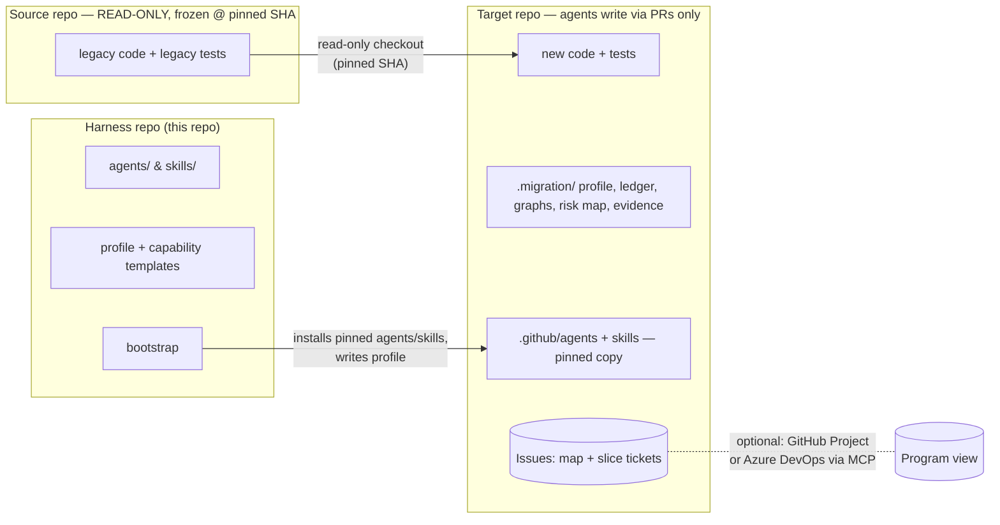
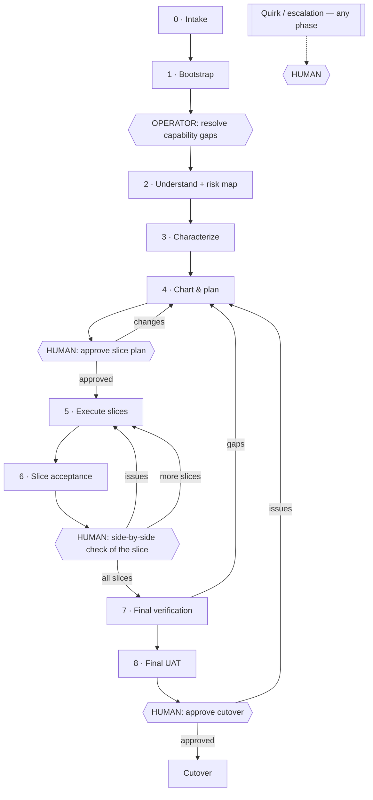
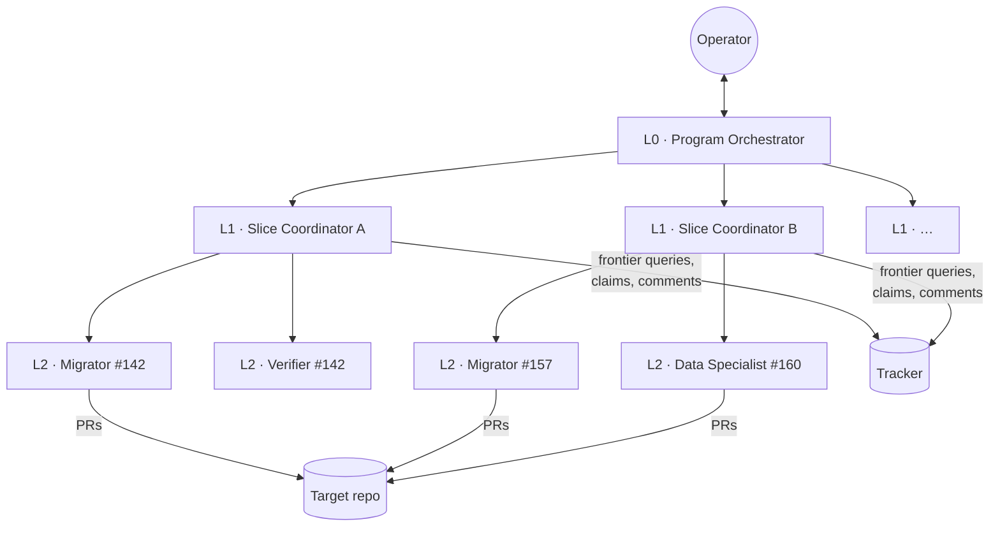

# AI Factory Swarm — Architecture

> Status: **Draft v0.2** (2026-10-30). Baseline: the `migrating-java-to-django` skill and its role
> agents in [code-migration-hackathon PR #6](https://github.com/martins-vds/code-migration-hackathon/pull/6).
> This document generalizes that work into a language-agnostic, multi-agent harness that scales to
> codebases of any size. Decisions are recorded as ADRs in [`docs/adr/`](adr/), terms are defined in
> [`GLOSSARY.md`](../GLOSSARY.md), and the delivery plan is in [`roadmap.md`](roadmap.md).

## Contents

1. [Purpose and the fidelity contract](#1-purpose-and-the-fidelity-contract)
2. [Decisions at a glance](#2-decisions-at-a-glance)
3. [Repository topology](#3-repository-topology)
4. [Agent roles](#4-agent-roles)
5. [Lifecycle](#5-lifecycle)
6. [Built-in skill menu and required capabilities](#6-built-in-skill-menu-and-required-capabilities)
7. [The migration profile](#7-the-migration-profile)
8. [The code graph](#8-the-code-graph)
9. [The fidelity ledger](#9-the-fidelity-ledger)
10. [Verification model](#10-verification-model)
11. [Data migration workstream](#11-data-migration-workstream)
12. [Work tracking](#12-work-tracking)
13. [Orchestration and scaling](#13-orchestration-and-scaling)
14. [Human in the loop](#14-human-in-the-loop)
15. [What carries over from PR #6](#15-what-carries-over-from-pr-6)
16. [Known risks](#16-known-risks)

---

## 1. Purpose and the fidelity contract

AI Factory Swarm is a fleet of agents that rewrites an application from one stack to another
(language A → language B, or language A → a newer version of A) with **high fidelity**: the new
application does what the old one does.

Every agent carries this contract in context at all times:

> **Preserve observable behavior. Re-architect freely behind it. Surface every quirk to a human.**

- **Observable behavior** is anything visible from outside the application: API requests and
  responses, UI screens, flows and states, data written to stores, messages published, files
  produced, calls to external systems, scheduled-job effects, error responses and authorization
  decisions. This is the **equivalence boundary** ([ADR-0001](adr/0001-behavioral-equivalence-at-observable-boundaries.md)).
- **Behind the boundary**, the target is idiomatic for the new stack and follows modern design:
  domain-driven design, clean architecture, dependency injection, clean code and appropriate design
  patterns. Structural similarity to the source is *not* a goal.
- **The UI is always rewritten in the target's front-end stack.** What users can *do* (screens,
  fields, flows, validations, states, permissions) is inside the boundary and must match. How it
  *looks* (visual design, design system) is a human decision on the decision map: keep the current
  look or modernize it ([ADR-0014](adr/0014-ui-functional-fidelity-visual-direction-by-decision.md)).
- **Quirks and bugs** discovered in the source are never silently preserved and never silently
  fixed. They are raised to a human **at the moment of discovery** ([ADR-0007](adr/0007-quirks-escalate-immediately.md)).
- **Lose nothing silently.** Every capability of the source is migrated or explicitly documented as
  deferred / replaced / dropped, with a human-approved justification.

**Definition of done:** a target application, with its data migrated, running side by side with the
legacy application on a copy of production data, verified slice by slice and then end to end by
humans, and approved for cutover.

---

## 2. Decisions at a glance

| # | Decision | ADR |
|---|----------|-----|
| 1 | Equivalence is judged at observable boundaries; internals may be fully re-architected | [0001](adr/0001-behavioral-equivalence-at-observable-boundaries.md) |
| 2 | Three repositories: harness, source (read-only, frozen, pinned), target | [0002](adr/0002-three-repository-topology.md) |
| 3 | Matt Pocock's skills are the spine; user-invoked skills stay human-triggered at L0, vendored copies at L1/L2 | [0003](adr/0003-mattpocock-skills-as-spine.md) |
| 4 | Two-level tracking (decision map + slice tickets) in the target repo; Azure DevOps via MCP | [0004](adr/0004-two-level-tracking-in-target-repo.md) |
| 5 | Characterization tests are mandatory before migration; "review-only" is the human-signed fallback | [0005](adr/0005-characterization-first.md) |
| 6 | Automated differential checks first; human side-by-side check per slice; final UAT; single cutover | [0006](adr/0006-side-by-side-then-cutover.md) |
| 7 | Quirks escalate immediately as blocking question tickets assigned to a human | [0007](adr/0007-quirks-escalate-immediately.md) |
| 8 | Layered orchestration; local subagents or the Copilot coding agent; agents live only in the target repo | [0008](adr/0008-layered-orchestration.md) |
| 9 | Understand Anything is the single graph tool, used directly; source snapshot committed once | [0009](adr/0009-understand-anything-as-graph-tool.md) |
| 10 | Data migration is its own workstream with its own slices and tests | [0010](adr/0010-data-migration-workstream.md) |
| 11 | CRAP and mutation testing are mandatory quality gates on the target | [0011](adr/0011-crap-and-mutation-gates.md) |
| 12 | Built-in skill menu + required-capability checklist; gaps are resolved by the operator before migration starts | [0012](adr/0012-skill-menu-and-capability-gaps.md) |
| 13 | A best-effort CRAP risk map of the source guides characterization, planning and refactoring; it never blocks | [0013](adr/0013-source-risk-map.md) |
| 14 | UI: functional fidelity is mandatory; visual direction (keep or modernize) is decided on the map | [0014](adr/0014-ui-functional-fidelity-visual-direction-by-decision.md) |
| 15 | Context budget per agent, checkpoint-and-restart, and tool output kept on disk behind wrappers and hooks | [0015](adr/0015-context-budget-and-output-hygiene.md) |

---

## 3. Repository topology



| Repo | Purpose | Agent access |
|------|---------|--------------|
| **Harness** | Generic role agents, harness skills, the built-in skill menu, profile and capability templates, bootstrap logic. Versioned and released. | Read. Changed only by humans. |
| **Source** | The legacy application and its tests. | **Read-only, enforced by credentials** (read-only token / deploy key). Frozen for the life of the migration and **pinned to a commit SHA**. Agents work on a local checkout that is never pushed. |
| **Target** | The new application plus all migration state: profile, ledger, graph snapshots, risk map, evidence, tickets, and the pinned agents and skills. | Write, **only through pull requests**. `main` is protected; merges need human approval. |

Agents live **only in the target repo**, as pinned copies installed by bootstrap
([ADR-0008](adr/0008-layered-orchestration.md)). A harness upgrade mid-migration is an explicit PR.

**Target repo layout:**

```
/
├── GLOSSARY.md                   # domain language (domain-modeling)
├── docs/adr/                     # target-architecture decisions
├── docs/agents/                  # tracker + domain config (setup-matt-pocock-skills)
├── .github/agents/               # role agents, pinned copy from harness
├── .agents/skills/               # skill menu + stack skills resolved by the profile, pinned
├── .migration/
│   ├── runs/                     # full command logs from afs-run (gitignored; linked as evidence)
│   ├── profile.yaml              # the migration profile (§7)
│   ├── source.lock               # source repo URL + pinned SHA
│   ├── capabilities.yaml         # required-capability checklist and how each is met (§6)
│   ├── ledger/                   # fidelity ledger, one file per capability (§9)
│   ├── graphs/source/            # Understand Anything snapshot of the source at the pinned SHA
│   ├── graphs/target/            # target graph, updated incrementally per slice
│   ├── risk-map/                 # CRAP risk map of the source (§10.4)
│   ├── characterization/         # harness + recorded golden behavior from the source
│   ├── data/                     # data-migration pipeline specs and reconciliation results (§11)
│   └── evidence/                 # per-slice gate and acceptance reports
└── src/ …                        # the new application
```

---

## 4. Agent roles

Roles evolve from PR #6's seven agents. New roles are marked ★.

| Role | Layer | Responsibility | Writes |
|------|-------|----------------|--------|
| **Program Orchestrator** | L0 | Intake; owns the decision map, slice plan, human gates, escalations and cutover readiness. Dispatches slice coordinators. Never writes application code. Human-triggered. | Tracker, `.migration/` (via PR) |
| ★ **Bootstrapper** | L0 | Detects stacks, runs the capability checklist, builds the profile, installs pinned agents and skills, configures the tracker, scaffolds the target. Opens operator tickets for capability gaps. | Target repo (setup PR) |
| **Analyst** | L1 | Builds the source graph and domain graph with Understand Anything, inventories every capability into the ledger, produces the source risk map, flags quirk candidates. | Ledger, graph snapshot, risk map |
| ★ **Characterizer** | L1 | Builds a harness around the source and records its observable behavior as characterization tests; inventories legacy tests and the behavior they assert; re-runs the risk map with characterization coverage. | `.migration/characterization/`, ledger |
| **Planner** | L1 | Proposes vertical slices from the graph, ledger and risk map, with dependency edges and sizing; includes data-migration slices. | Draft slice plan |
| ★ **Slice Coordinator** | L1 | Owns one slice end to end: sequences its tickets on the frontier, dispatches workers, runs slice acceptance, keeps the ledger in sync. | Tracker comments, evidence |
| **Migrator** | L2 | Implements exactly one ticket test-first in the target. One per ticket; many in parallel. | Target code (one PR per ticket) |
| **Specialist Migrator** | L2 | Profile-defined specialists: **data migration** (§11), **UI** (rebuilds screens in the target front end following the chosen UI direction, with `ui-ux-pro-max`), messaging, etc. PR #6's DB Migrator becomes the data specialist. | Target code, data pipeline |
| **Verifier** | L2 | Fresh context, no builder reasoning. Runs the per-PR gates (§10.3), including CRAP and mutation on changed code; adds tests where coverage or mutation score is short. Reports, never fixes production code. | Tests, evidence |
| **Auditor** | L1 / L0 | Read-only, first-principles. Per slice: capability coverage and differential checks. Final: full bidirectional audit and the A–G report. Ignores progress labels. | Evidence report |

Rules carried over from PR #6 and kept binding:

- **Artifacts, not conversation.** Hand-offs pass ids and paths (ticket, profile, ledger, graph).
- **Independent verification.** Verifier and Auditor never receive the builder's reasoning.
- **Verify, don't trust.** A coordinator re-reads fresh evidence before accepting "done".
- **Stop rules.** Same failure after two honest attempts, a real limit, or a graph discrepancy →
  stop and escalate.
- **No hidden state.** Discovered work, reorderings and deferrals are written down immediately.
- **Graph first.** Query the graph before reading source files; correct the graph when it is wrong.
- **Lessons learned.** Recurring mistakes are captured and recalled before each ticket.

---

## 5. Lifecycle



### Phase 0 — Intake (Program Orchestrator)
Record the source repo URL and **pinned SHA**, target repo, target stack and version — **back end and
front end** — tracker, data stores, and who takes production snapshots (usually the operations team). Write
`.migration/source.lock`.

### Phase 1 — Bootstrap (Bootstrapper)
1. Detect source stacks (languages, frameworks, build tools, data stores, UI tech, integrations).
2. Run the **required-capability checklist** (§6): for each capability, find a skill or tool for the
   source and target stacks — first in the built-in skill menu, then with `find-skills`.
3. **Gaps stop the migration.** Each unmet capability becomes an operator ticket. The operator finds
   a skill, writes one (e.g. with `skill-creator`), or records an approved waiver. Bootstrap is
   deliberately not fully automated ([ADR-0012](adr/0012-skill-menu-and-capability-gaps.md)).
4. Run `setup-matt-pocock-skills` against the target (tracker, labels, domain-doc layout).
5. Install pinned agents and skills into the target; scaffold it (layout, CI, lint/format, test
   runner, coverage, CRAP and mutation tooling, containers) per the target-architecture ADRs.
6. Delivered as one **setup PR** that a human merges.

### Phase 2 — Understand (Analyst)
1. Run Understand Anything `/understand` and `/understand-domain` on a local checkout of the source at
   the pinned SHA, always, regardless of size. Commit the snapshot to `.migration/graphs/source/`
   ([ADR-0009](adr/0009-understand-anything-as-graph-tool.md)).
2. Inventory every capability into the ledger: structural (from the graph), behavioral (side effects,
   error handling, config-driven branches, edge cases), **UI** (screens, flows, forms, states,
   bindings), **integrations**, and **data** (tables, schemas, stored procedures, reports).
3. Build the **source risk map**: run CRAP (or its inputs: complexity and coverage) over the source,
   best effort ([ADR-0013](adr/0013-source-risk-map.md)). Failure is logged, never blocking.
4. Ignore existing migration/porting docs; use understanding docs only; never let docs outrank code.
5. Quirk candidates are escalated immediately (§14).

### Phase 3 — Characterize (Characterizer)
Mandatory, before any migration ([ADR-0005](adr/0005-characterization-first.md)):
1. **Inventory legacy tests.** Record the behavior each one asserts as ledger evidence. That behavior
   must reappear as a test in the target, in the target's idiom.
2. **Characterize at the equivalence boundary.** Drive the source through its external interfaces
   (HTTP, UI, CLI, queue, batch input, DB state) and record inputs → observable outputs: normal,
   empty/null/zero and boundary cases. Spend most effort where the risk map is hottest.
3. **Re-run the risk map** with coverage collected while characterization ran, where the stack
   allows. Complex code the characterization never reached is the top characterization gap.
4. **Fallback.** A capability that cannot reasonably be characterized is marked `review-only` and
   needs a human tester's sign-off.

### Phase 4 — Chart & plan (Program Orchestrator + Planner)
1. **Chart the decision map** with `wayfinder` (human-triggered): target architecture and bounded
   contexts, library and idiom mappings, data model and migration strategy, cross-cutting concerns,
   and the **UI direction**: keep the current look or modernize it, and if modernizing, the design
   system. The UI direction is a `wayfinder:prototype` ticket that uses `ui-ux-pro-max` to produce
   options for a human to choose from. Decisions land as ADRs and glossary entries in the target repo.
2. **Draft slices.** Vertical paths through every layer, anchored on an observable entry point and
   testable end to end against their characterization tests. Dependencies come from graph edges;
   shared foundations (domain model, persistence, auth) come first. **Data-migration slices** are
   planned alongside the slices that need their data (§11).
3. **Hot spots get a design step.** Slices touching high-CRAP or brittle areas get an explicit design
   ticket using the architecture and refactoring skills (§6) before implementation tickets.
4. Every ledger capability maps to a slice or to an explicit, justified deferral.
5. **Human gate:** the operator approves the slice plan. Then `to-tickets` publishes it (§12).

### Phase 5 — Execute (Slice Coordinators → Migrators / Verifiers)
For each ticket on the frontier:
1. Coordinator claims it and dispatches a Migrator with the ticket id and profile, ledger and graph
   paths.
2. Migrator: resolve dependencies from the graph → write failing target tests from the ticket's
   characterization cases and transcribed legacy tests → implement idiomatically → refactor →
   run gates → open a PR that closes the ticket and updates its ledger entries.
3. Verifier (fresh context) runs the per-PR gates (§10.3) and adds tests where coverage or mutation
   score falls short.
4. **Human gate:** PR review and merge.
5. Out-of-scope discoveries become new tickets; quirks become question tickets (§14).

### Phase 6 — Slice acceptance (Slice Coordinator + Auditor)
When every ticket in the slice is merged:
1. Run the slice's end-to-end characterization suite against the target.
2. Run **automated differential checks** where feasible (§10.2).
3. Run full mutation testing on the slice's code.
4. Update the target graph incrementally, run the capability-coverage check and reconcile the ledger.
5. Write evidence to `.migration/evidence/<slice>/`.
6. **Human gate:** a person compares legacy and target side by side for the slice's flows. Issues come
   back as tickets.

### Phase 7 — Final verification (Auditor)
Carried over from PR #6's final-verification pass: refresh the target graph, verify **top-down** from
every screen/route/workflow and **bottom-up** from every non-UI capability, ignore progress labels and
re-prove from code + graphs + tests, and emit the structured **A–G report**. Unresolved gaps block
Phase 8.

### Phase 8 — Final UAT and cutover ([ADR-0006](adr/0006-side-by-side-then-cutover.md))
1. Run the data-migration pipeline on a fresh production snapshot (a dress rehearsal of cutover).
2. Test users exercise the whole target side by side with the running legacy application.
3. Every `review-only` capability gets a human-tester sign-off.
4. Discrepancies loop back through Phase 4/5.
5. **Human gate:** cutover approval. The legacy application stays available until cutover is
   accepted; that is the rollback path.

---

## 6. Built-in skill menu and required capabilities

### 6.1 Built-in skill menu
Language-agnostic skills shipped with the harness and installed into every target
([ADR-0012](adr/0012-skill-menu-and-capability-gaps.md)). Pinned by commit. Skills marked *(hackathon)*
come from the [code-migration-hackathon](https://github.com/martins-vds/code-migration-hackathon)
skill set used by PR #6; skills marked *(candidate)* are evaluated in milestone M2
([roadmap](roadmap.md)) before they are pinned.

| Category | Skills | Source |
|----------|--------|--------|
| Planning & tracking | `wayfinder`, `to-tickets`, `to-spec`, `grilling`, `setup-matt-pocock-skills` | mattpocock/skills |
| Domain & design | `domain-modeling`, `codebase-design`, `improve-codebase-architecture` | mattpocock/skills |
| Architecture | `architecture-patterns` (clean, hexagonal, DDD) *(hackathon)* | wshobson/agents |
| | `architecture-blueprint-generator` (narrative blueprint of the source) *(hackathon)* | github/awesome-copilot |
| | `clean-architecture`, `domain-driven-design`, `patterns-of-enterprise-application-architecture` *(candidate)* | ciembor/agent-rules-books |
| **Refactoring** | `refactoring` (Fowler), `refactoring-guru` (design patterns), `clean-code`, `working-effectively-with-legacy-code` (seams, characterization) *(candidate)* | ciembor/agent-rules-books |
| Build & verify | `tdd`, `implement` | mattpocock/skills |
| | `verification-before-completion` (evidence before claims) *(hackathon)* | obra/superpowers |
| Review & debugging | `code-review`, `pr`, `diagnosing-bugs` | mattpocock/skills |
| | `receiving-code-review` (responding to review feedback with rigor) *(hackathon)* | obra/superpowers |
| Orchestration | `dispatching-parallel-agents`, `using-git-worktrees` (isolation for parallel local workers) *(hackathon)* | obra/superpowers |
| Runtime & environments | `docker-expert` *(hackathon)* | sickn33/antigravity-awesome-skills |
| | `multi-stage-dockerfile` *(hackathon)* | github/awesome-copilot |
| | `docker-compose-orchestration` *(hackathon)* | manutej/luxor-claude-marketplace |
| UI design | `ui-ux-pro-max` (design systems, UX and accessibility rules, per-stack guidance; needs Python 3 for its search scripts) *(hackathon)* | nextlevelbuilder/ui-ux-pro-max-skill |
| UI end-to-end | `agent-browser` (web UIs) *(hackathon)* | vercel-labs/agent-browser |
| Data | `db-seed` (realistic, FK-ordered, idempotent seed data; SQL Server and Oracle today, extend with more engine references as needed) *(hackathon)* | code-migration-hackathon (local) |
| Documentation | `documentation-writer` (Diátaxis) *(hackathon)* | github/awesome-copilot |
| Memory | `lessons-learned` *(hackathon)* | code-migration-hackathon (local) |
| Capability gaps | `find-skills` *(hackathon)* | vercel-labs/skills |
| | `skill-creator` (Apache-2.0) *(hackathon)* | anthropics/skills |
| | `self-learning` (research a technology and bundle it as a skill) *(hackathon)* | code-migration-hackathon (local) |
| Research | `research` | mattpocock/skills |
| Code graph | `understand`, `understand-domain`, `understand-chat`, `understand-explain`, `understand-diff` | Understand Anything |
| Harness | migration contract, ledger and evidence writers, quirk ticket | this repo |

The harness **migration contract** is generalized from PR #6's `migrating-java-to-django` references
(methodology, validation metrics, graph comparison, final verification), with the Java/Django specifics
moved into the reference stack pack. The Docker skills support the characterization harness, the second
legacy instance and the side-by-side environments. `db-seed` generates data for characterization and
test environments when no production snapshot is available, and for target test databases; supporting
a new engine (e.g. PostgreSQL) means adding an engine reference to it, handled as a capability gap.

The four Superpowers skills were checked against upstream (`obra/superpowers` `2ce8aa1`, MIT): none
references another skill, so each works on its own; other Superpowers skills reference *them*, which
does not matter here. Pin the **upstream** versions, not the older hackathon copies (the hackathon
`using-git-worktrees` still defaults to a `~/.config/superpowers/` path).

**Not taken from the hackathon set, and why:**

| Skills | Reason |
|--------|--------|
| `brainstorming`, `writing-plans`, `executing-plans`, `subagent-driven-development`, `finishing-a-development-branch`, `using-superpowers`, all `speckit-superb-*` | Competing planning/execution spine; Matt Pocock's skills are the spine (ADR-0003) |
| `test-driven-development`, `systematic-debugging`, `requesting-code-review` | Duplicates of `tdd`, `diagnosing-bugs`, `code-review` |
| `create-architectural-decision-record` | `domain-modeling` already writes ADRs to `docs/adr/` |
| `pdf`, `docx`, `xlsx` | Anthropic proprietary license: cannot be redistributed into target repos; use them only where the agent platform already provides them |
| `java-docs`, `java-junit`, `django-*`, `pytest-coverage`, `python-performance-optimization`, Oracle/PostgreSQL skills | Language- or stack-specific: belong in stack packs, selected by the profile |
| `migrating-java-to-django` | Stack-specific; its references become the harness migration contract |

### 6.2 Required-capability checklist
Capabilities every migration needs, per stack. Bootstrap fills `.migration/capabilities.yaml` with
how each is met; any unmet item is an operator ticket that blocks Phase 2.

| Capability | Needed for | Example tools (vary by stack) |
|------------|-----------|-------------------------------|
| Build / run | source and target | Maven, dotnet, pip/uv, npm |
| Characterization harness | source | HTTP recorders, UI drivers, DB snapshots, approval-test libraries |
| Unit / integration tests | target | JUnit, xUnit, pytest, Jest |
| Coverage | source (best effort), target | JaCoCo, coverlet, coverage.py, c8 |
| Complexity | source (best effort), target | lizard, radon, language linters |
| **CRAP** | source (best effort), target | crap4j, or computed from complexity + coverage |
| **Mutation testing** | target | PIT, Stryker, mutmut, cargo-mutants |
| Lint / format | target | ruff, eslint, dotnet format |
| Stack idioms & frameworks | source (read), target (write) | stack skills such as `django-patterns`, `java-docs` |
| Data migration | when data stores exist | schema/procedure translation skills, ETL tooling |
| UI end-to-end | when a UI exists | browser automation |

---

## 7. The migration profile

The profile replaces PR #6's hard-coded orchestration map. Everything stack-specific lives here;
no role agent names a language.

```yaml
# .migration/profile.yaml (illustrative)
harness_version: 0.2.0
source:
  repo: org/legacy-app
  sha: 3f9c2e1…
  stacks: [java-17, spring-boot-2, jsf, oracle-19c, mybatis]
target:
  repo: org/new-app
  stacks: [python-3.13, django-5, postgresql-17]
  architecture:
    style: clean-architecture
    adrs: [docs/adr/0001-bounded-contexts.md, docs/adr/0002-di-container.md]
skills:                              # stack-specific skills; the built-in menu is always present
  source:
    read: [java-docs]
    characterize: [java-junit]
  target:
    patterns: [django-patterns]
    security: [django-security]
    async: [django-celery]
  specialists:
    data: [reviewing-oracle-to-postgres-migration, migrating-oracle-to-postgres-stored-procedures]
gates:                               # commands per gate (§10.3)
  build: ["python -m compileall src", "python manage.py check"]
  idiom: ["ruff check", "ruff format --check"]
  tests: ["pytest -q"]
  crap: ["<crap command>"]
  mutation_changed: ["mutmut run --paths-to-mutate {changed}"]
  mutation_full: ["mutmut run"]
thresholds:                          # operator-set
  crap_max_per_method: 30
  mutation_score_min: 0.80
concurrency:                         # operator-set
  max_parallel_workers: 6
  remote_workers: true
data:
  masking: false                     # nice to have; set true if a masking step is available
  snapshot_owner: operations-team
translation_rules: .migration/translation-rules.md
```

---

## 8. The code graph

**Understand Anything is the single graph tool, used directly — no adapter**
([ADR-0009](adr/0009-understand-anything-as-graph-tool.md)).

Why it fits a migration: its graph has the node and edge types the ledger and slices are built from:
endpoints, tables, services, schemas, screens, and domain → flow → step nodes with entry points
(http, cli, event, cron) and business rules; edges include `calls`, `reads_from`, `writes_to`,
`publishes`, `routes`, `triggers` and `tested_by`.

How it is used:

| When | Command | Output |
|------|---------|--------|
| Phase 2, once | `/understand`, `/understand-domain` on the source at the pinned SHA | `knowledge-graph.json`, `domain-graph.json` → `.migration/graphs/source/` |
| Any time | `/understand-chat`, `/understand-explain` | Answers grounded in the graph |
| Per slice | `/understand` on the target (incremental: only changed files re-analyzed) | `.migration/graphs/target/` |
| Per PR | `/understand-diff` | Blast radius of the change |

Because the source is frozen, the source graph is built **once** and committed; its cost is paid
once and its LLM-generated content does not drift. Understand Anything writes its data next to the
analyzed code, so it runs on a local, never-pushed checkout of the source and the result is copied
into the target repo.

---

## 9. The fidelity ledger

The inventory of every source capability and its fate. **Structured data, one file per capability**
under `.migration/ledger/`, so parallel PRs rarely conflict and the ledger can be queried.

```yaml
# .migration/ledger/billing.invoice.charge-rounding.yaml
id: billing.invoice.charge-rounding
kind: behavioral            # structural | behavioral | ui | integration | data
source:
  graph_node: function:billing/src/main/java/com/acme/billing/InvoiceService.java:charge
  risk: { crap: 182, complexity: 14, coverage: 0.0 }
boundary: "POST /invoices/{id}/charge → response body, invoice.amount_charged"
slice: billing-charge-invoice
tickets: [org/new-app#142]
target:
  components: [billing.application.charge_invoice, billing.domain.Money]
status: migrated            # pending | in-progress | migrated | deferred | replaced | dropped
verification: characterized # differential | characterized | legacy-test | review-only
evidence:
  - .migration/characterization/billing/charge_rounding.json
  - tests/billing/test_charge_invoice.py::test_half_even_rounding
quirks: [org/new-app#150]
approval: null              # required for deferred | replaced | dropped | review-only
```

Rules:
- `deferred`, `replaced` and `dropped` require a justification and a human approval reference.
- `review-only` requires a human-tester sign-off before cutover.
- Ledger changes ride in the same PR as the code that justifies them.

---

## 10. Verification model

### 10.1 Evidence ladder
Strongest to weakest; each capability records the rung it reached.

1. **Differential observation** — the same inputs sent to legacy and target from the same starting
   data; outputs compared (automated in Phase 6; by people in the slice check and final UAT).
2. **Characterization tests** — recorded source behavior replayed against the target.
3. **Transcribed legacy tests** — behavior the legacy suite asserted, re-expressed in the target.
4. **Graph capability coverage** — every source capability maps to target components and at least
   one passing test.
5. **Review only** — human review and exploratory testing; requires sign-off.

### 10.2 Automated differential checks
Before any human looks at a slice, as much as possible is automated:
- Replay the slice's characterization inputs (and recorded traffic, if available) against both
  applications.
- Compare normalized outputs, ignoring fields that legitimately differ (generated ids, timestamps).
- For writes to be comparable, both applications must start from the same data: run a second legacy
  instance on its own copy of the snapshot where possible. Where that is not possible, only
  read-only requests are replayed against the running legacy application, and writes rely on
  characterization tests and the human check.

### 10.3 Gates
| Gate | Question | Runs |
|------|----------|------|
| 1 · Build | Compiles, loads and configures cleanly? | every PR |
| 2 · Behavior | Characterization and transcribed legacy tests pass at the boundary? | every PR |
| 3 · Idiom & architecture | Idiomatic; conforms to target ADRs (layers, DI, domain boundaries)? | every PR |
| 4 · **CRAP** | No method above the CRAP threshold (default 30)? | every PR |
| 5 · **Mutation** | Mutation score on new/changed code ≥ threshold (default 80%)? | every PR (changed code); full at slice acceptance |
| 6 · Regression | Full suite still green; earlier slices unaffected? | every PR (CI) |
| 7 · Capability coverage | Every capability in scope accounted for and evidenced? | slice acceptance, final |

A gate passes only on fresh command output from the current step. CRAP and mutation are language-
agnostic concepts; the commands come from the profile ([ADR-0011](adr/0011-crap-and-mutation-gates.md)).

### 10.4 Source risk map
A CRAP-based ranking of the source, built in Phase 2 and refreshed in Phase 3
([ADR-0013](adr/0013-source-risk-map.md)):
- **Best effort, never blocking.** If the tooling fails on the legacy code, the failure is logged
  and work continues.
- **With no source tests**, coverage is zero and CRAP reduces to a complexity ranking, still a
  useful pointer. **After characterization**, coverage collected during characterization makes it
  sharper.
- **Used by:** the Characterizer (where to characterize hardest), the Planner (which slices get a
  design step), and Migrators (hot spots are redesigned with the architecture and refactoring skills
  instead of translated). Refactoring happens in the target; the source is never changed.

### 10.5 Why graph comparison becomes capability coverage
With freedom to re-architect, a node-for-node diff of source and target graphs is mostly noise. Gate
7 asks: does every capability in the source graph and ledger have (a) a target counterpart and (b)
passing evidence at the boundary? PR #6's five gap classes still apply at the boundary: missing
capability, misplaced responsibility, broken flow, missing integration, untested path.

---

## 11. Data migration workstream

Re-architecting the domain usually changes the data model, so moving the data is its own
workstream ([ADR-0010](adr/0010-data-migration-workstream.md)):

- **Deliverable:** a repeatable pipeline that converts legacy data into the target schema, run by the
  Data Specialist Migrator, tracked as its own slices and tickets.
- **Tests:** reconciliation checks (row counts, checksums, referential integrity) and business
  invariants that must hold after conversion, plus characterization of legacy stored procedures and
  reports that the target replaces.
- **Planning:** data slices are scheduled before or alongside the application slices that read the
  data, linked by blocking edges.
- **Production copy:** the operations team provides a snapshot; the pipeline turns it into the
  target's copy for side-by-side checks. Every refresh doubles as a cutover rehearsal.
- **Seed data:** where no snapshot is available (e.g. early characterization or test environments),
  `db-seed` generates realistic, foreign-key-ordered seed data.
- **Masking:** nice to have. If a masking step is available it runs on the snapshot before the
  pipeline (`profile.data.masking`).

---

## 12. Work tracking

Two levels ([ADR-0004](adr/0004-two-level-tracking-in-target-repo.md)); the goal is a working
application, not a particular hierarchy.

| Level | Holds | Created by | Shape on GitHub |
|-------|-------|------------|-----------------|
| **Decision map** | Architecture, mappings, data strategy, **quirk rulings**, capability gaps | `wayfinder` | One `wayfinder:map` issue; decision tickets as sub-issues with `wayfinder:<type>` labels |
| **Slice tickets** | Build work: one ticket per agent session, acceptance criteria from the ledger | `to-tickets` | `ready-for-agent` issues grouped under a slice parent via sub-issues; native blocking edges |

- **Frontier:** open, unblocked, unclaimed tickets. Coordinators pull only from the frontier.
- **Claim:** assign before any work, so concurrent agents skip it.
- **Decisions block builds** only where they apply (native blocking edges).
- **Sizing:** one ticket fits one fresh agent context; wide mechanical changes use expand →
  migrate-in-batches → contract.
- **Azure DevOps:** expressed as a tracker doc backed by the Azure DevOps MCP server
  (`setup-matt-pocock-skills` "Other" option). Roles follow the tracker doc, never a specific API.

---

## 13. Orchestration and scaling



**Scaling principle:** no agent holds the whole migration in context. State lives in the tracker and
`.migration/`; each agent loads only the view it needs (the map, its slice, its ticket) and zooms
into the graph on demand.

**Skill invocation by layer** ([ADR-0003](adr/0003-mattpocock-skills-as-spine.md)):
- **L0** runs with the operator present; user-invoked skills (`wayfinder` charting, `to-tickets`,
  `setup-matt-pocock-skills`) are triggered by the operator.
- **L1 / L2** use harness-vendored copies of the skills they must run on their own (e.g.
  `afs-to-tickets`, `afs-implement`, `afs-wayfinder-work`), pinned, prefixed and attributed (MIT).

**Dispatch** ([ADR-0008](adr/0008-layered-orchestration.md)). The same role agent file runs:
- **locally**, as a custom agent / subagent in VS Code or the Copilot CLI; or
- **remotely**, by assigning the ticket to the **Copilot coding agent** with the named custom agent
  (via the UI or API). It works in the target repo, opens a PR, and reports on the ticket.

Remote workers get a read-only checkout of the source at the pinned SHA in their setup steps.

**Context management** ([ADR-0015](adr/0015-context-budget-and-output-hygiene.md)). No agent runs a long
session: one ticket per fresh session, tickets sized to an operator-set working budget, and a
checkpoint-and-restart handoff at a soft limit. Tool output stays out of context: shell commands go through RTK
(compact output for Maven, Gradle and 100+ other commands, full output recoverable), gate runs go
through the `afs-run` wrapper (RTK plus a raw log in `.migration/runs/` for evidence), and Copilot
`preToolUse` hooks rewrite or deny unbounded commands with guidance. RTK and the harness each keep
their own marked block in `.github/copilot-instructions.md`.

**Concurrency rules.**
- Parallelize only tickets with no dependency edge and no shared files.
- One PR per ticket; per-capability ledger files keep parallel PRs from conflicting.
- Every operation is idempotent and resumable from the ticket alone.
- Parallelism and the local/remote mix are operator-set profile values, never inferred by agents.

---

## 14. Human in the loop

| Gate / event | Who | Blocks |
|--------------|-----|--------|
| Capability gap (no skill/tool for a required capability) | Operator | Phase 2 onward |
| Setup PR | Operator | Phase 2 onward |
| Slice plan approval | Operator | Execution |
| Each PR merge | Reviewer | That ticket |
| Quirk / bug in source | Any human; they may consult a domain expert | Only dependent tickets |
| Deferral / replacement / drop of a capability | Any human | That capability |
| Stop-rule escalation | Operator | That ticket or slice |
| Side-by-side check of a slice | Human tester | Slice closure |
| `review-only` sign-off | Human tester | Cutover |
| Final UAT and cutover | Operator / business owner | Go-live |

**Quirk ticket** (decision-map ticket, `wayfinder:grilling`), raised the moment a quirk is found:

```markdown
## Question
<What the source does, in one sentence.> Preserve, fix, or something else?

## Evidence
- Source: <graph node / file:line at pinned SHA>
- Characterization: <recorded input → output>
- Why it looks wrong: <expected vs actual>

## Impact
- Ledger capabilities: <ids>
- Blocks: <ticket links>

## Options
1. Preserve exactly (target reproduces the quirk; test pins it)
2. Fix (target diverges; divergence documented in ledger)
3. Other
```

The agent never answers its own question; the human who receives it decides whether to involve a
domain expert. The answer is recorded on the ticket and in the affected ledger entries, with a test
that pins the chosen behavior.

---

## 15. What carries over from PR #6

| PR #6 (Java → Django) | AI Factory Swarm |
|-----------------------|------------------|
| Hard-coded orchestration map of Java/Django/Oracle skills | Built-in skill menu + capability checklist + migration profile (§6, §7) |
| Seven role agents | Kept and generalized; adds Bootstrapper, Characterizer, Slice Coordinator (§4) |
| Plan doc + markdown ledger + TodoWrite held by one orchestrator | Tracker + per-capability ledger files in the target repo (§9, §12) |
| Orchestrator verifies every result | Layered: coordinators verify their slice; L0 verifies slices (§13) |
| `SOURCE_DIR` / `OUTPUT_DIR` in one repo | Separate source (read-only, pinned) and target repos (§3) |
| Understand Anything, graph-first | Kept; source snapshot committed once; incremental target graphs (§8) |
| Golden behavior captured per increment | Characterization as a mandatory phase, guided by the risk map (§5) |
| Coverage-driven testing | Plus CRAP and mutation gates (§10.3) |
| DB Migrator agent | Data migration workstream with its own slices (§11) |
| Graph comparison at the end | Capability coverage per slice, plus a final reconciliation (§10.5) |
| "No big bang" | Incremental build; per-slice human check; single cutover after final UAT |
| Final verification A–G report, trust-but-verify, file-read gate, stop rules, lessons learned | Kept as is |
| Spec Kit + Superpowers + misc. skills | Matt Pocock's skills as the spine; others via the menu or profile |

---

## 16. Known risks

| Risk | Mitigation |
|------|------------|
| Understand Anything cannot parse a legacy language (e.g. COBOL, VB6) | Spike per new source language; Graphify is the fallback as a **swap**, not an addition (ADR-0009) |
| Full source graph is slow/expensive on very large codebases | One-time cost (frozen source); budget it in Phase 2 |
| Second legacy instance not available for write comparisons | Fall back to read-only replay + characterization + human check (§10.2) |
| No CRAP or mutation tool for a stack | Capability gap → operator ticket; compute CRAP from complexity + coverage where possible |
| Mutation testing is slow | Changed code per PR; full runs only at slice acceptance |
| Vendored skills drift from upstream | Pinned commits; harness release notes record upgrades |
| Copilot coding agent limits (plan, quotas, environment) | Local dispatch is always available; mix is operator-set |
| Context rot in long-running agents | One ticket per fresh session, working budget, checkpoint-and-restart, output hygiene (ADR-0015) |
