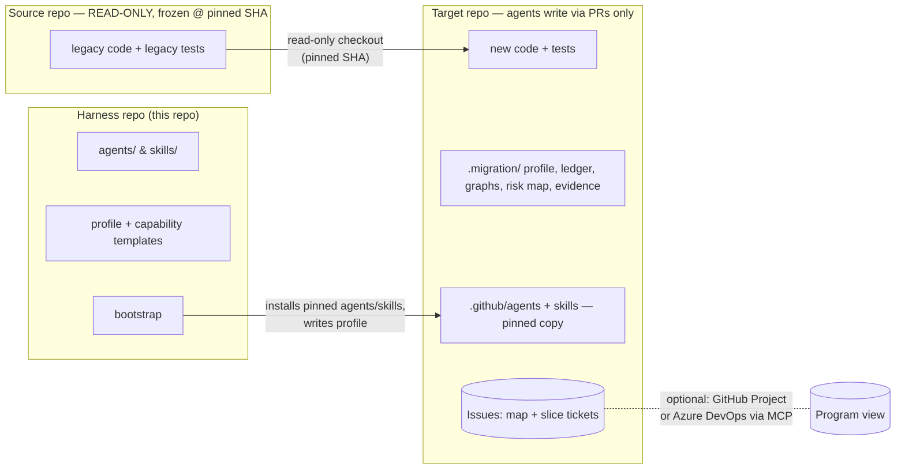
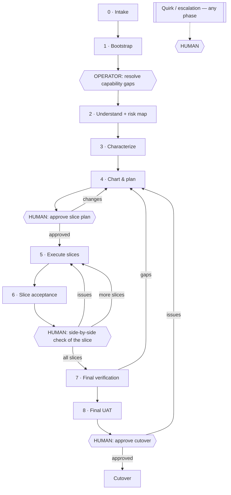
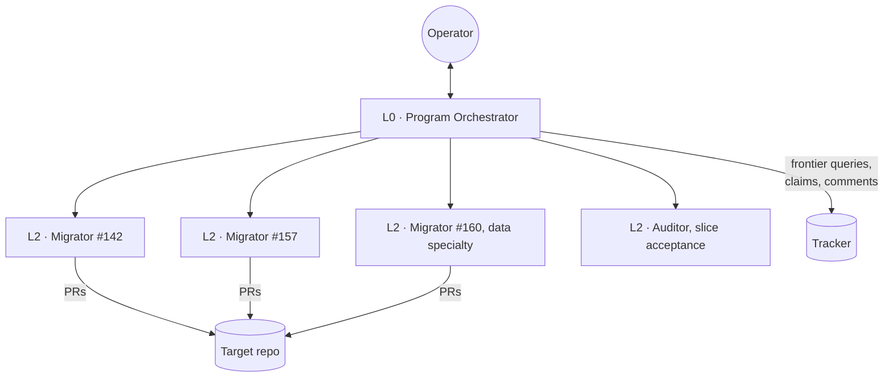

# AI Factory Swarm — Architecture

> Status: **Draft v0.2** (2026-10-30). Baseline: the `migrating-java-to-django` skill and its role
> agents in [code-migration-hackathon PR #6](https://github.com/martins-vds/code-migration-hackathon/pull/6).
> This document generalizes that work into a language-agnostic, multi-agent harness that scales to
> codebases of any size. Decisions are recorded as ADRs in [`docs/adr/`](adr/), terms are defined in
> [`GLOSSARY.md`](../GLOSSARY.md), and the delivery plan is in [`roadmap.md`](roadmap.md).

## Contents

1. [Purpose and the fidelity contract](#1-purpose-and-the-fidelity-contract)
2. [Decisions at a glance](#2-decisions-at-a-glance)
3. [Repository topology](#3-repository-topology)
4. [Agent roles](#4-agent-roles)
5. [Lifecycle](#5-lifecycle)
6. [Built-in skill menu and required capabilities](#6-built-in-skill-menu-and-required-capabilities)
7. [The migration profile](#7-the-migration-profile)
8. [The code graph](#8-the-code-graph)
9. [The fidelity ledger](#9-the-fidelity-ledger)
10. [Verification model](#10-verification-model)
11. [Data migration workstream](#11-data-migration-workstream)
12. [Work tracking](#12-work-tracking)
13. [Orchestration and scaling](#13-orchestration-and-scaling)
14. [Human in the loop](#14-human-in-the-loop)
15. [What carries over from PR #6](#15-what-carries-over-from-pr-6)
16. [Known risks](#16-known-risks)

---

## 1. Purpose and the fidelity contract

AI Factory Swarm is a fleet of agents that rewrites an application from one stack to another
(language A → language B, or language A → a newer version of A) with **high fidelity**: the new
application does what the old one does.

Every agent carries this contract in context at all times:

> **Preserve observable behavior. Re-architect freely behind it. Surface every quirk to a human.**

- **Observable behavior** is anything visible from outside the application: API requests and
  responses, UI screens, flows and states, data written to stores, messages published, files
  produced, calls to external systems, scheduled-job effects, error responses and authorization
  decisions. This is the **equivalence boundary** ([ADR-0001](adr/0001-behavioral-equivalence-at-observable-boundaries.md)).
- **Behind the boundary**, the target is idiomatic for the new stack and follows modern design:
  domain-driven design, clean architecture, dependency injection, clean code and appropriate design
  patterns. Structural similarity to the source is *not* a goal.
- **The UI is always rewritten in the target's front-end stack.** What users can *do* (screens,
  fields, flows, validations, states, permissions) is inside the boundary and must match. How it
  *looks* (visual design, design system) is a human decision on the decision map: keep the current
  look or modernize it ([ADR-0014](adr/0014-ui-functional-fidelity-visual-direction-by-decision.md)).
- **Quirks and bugs** discovered in the source are never silently preserved and never silently
  fixed. They are raised to a human **at the moment of discovery** ([ADR-0007](adr/0007-quirks-escalate-immediately.md)).
- **Lose nothing silently.** Every capability of the source is migrated or explicitly documented as
  deferred / replaced / dropped, with a human-approved justification.

**Definition of done:** a target application, with its data migrated, running side by side with the
legacy application on a copy of production data, verified slice by slice and then end to end by
humans, and approved for cutover.

---

## 2. Decisions at a glance

| # | Decision | ADR |
|---|----------|-----|
| 1 | Equivalence is judged at observable boundaries; internals may be fully re-architected | [0001](adr/0001-behavioral-equivalence-at-observable-boundaries.md) |
| 2 | Three repositories: harness, source (read-only, frozen, pinned), target | [0002](adr/0002-three-repository-topology.md) |
| 3 | Matt Pocock's skills are the spine; user-invoked skills stay human-triggered at L0, vendored copies at L1/L2 | [0003](adr/0003-mattpocock-skills-as-spine.md) |
| 4 | Two-level tracking (decision map + slice tickets) in the target repo; Azure DevOps via MCP | [0004](adr/0004-two-level-tracking-in-target-repo.md) |
| 5 | Characterization is mandatory before migration, at the best available tier (running environment, runnable in isolation, or source-only specs); "review-only" is the human-signed fallback | [0005](adr/0005-characterization-first.md) |
| 6 | Automated differential checks first; human side-by-side check per slice; final UAT; single cutover | [0006](adr/0006-side-by-side-then-cutover.md) |
| 7 | Quirks escalate immediately as blocking question tickets assigned to a human | [0007](adr/0007-quirks-escalate-immediately.md) |
| 8 | Layered orchestration; local subagents or the Copilot coding agent; agents live only in the target repo | [0008](adr/0008-layered-orchestration.md) |
| 9 | Understand Anything builds the graph, used directly; source snapshot committed once (amended by ADR-0025) | [0009](adr/0009-understand-anything-as-graph-tool.md) |
| 10 | Data migration is its own workstream with its own slices and tests | [0010](adr/0010-data-migration-workstream.md) |
| 11 | CRAP and mutation testing are mandatory quality gates on the target | [0011](adr/0011-crap-and-mutation-gates.md) |
| 12 | Built-in skill menu + required-capability checklist; gaps are resolved by the operator before migration starts | [0012](adr/0012-skill-menu-and-capability-gaps.md) |
| 13 | A best-effort CRAP risk map of the source guides characterization, planning and refactoring; it never blocks | [0013](adr/0013-source-risk-map.md) |
| 14 | UI: functional fidelity is mandatory; visual direction (keep or modernize) is decided on the map | [0014](adr/0014-ui-functional-fidelity-visual-direction-by-decision.md) |
| 15 | Context budget per agent, checkpoint-and-restart, and tool output kept on disk behind wrappers and hooks | [0015](adr/0015-context-budget-and-output-hygiene.md) |
| 16 | Test services (databases, brokers) start from one Docker Compose file named in the profile | [0016](adr/0016-test-services-from-one-compose-file.md) |
| 17 | Gate results come from the tools' own output lines, never from what an agent reports | [0017](adr/0017-gate-results-from-tools-not-agents.md) |
| 18 | Ledger evidence and runtimes are checked by tools, not trusted | [0018](adr/0018-evidence-and-runtime-are-checked-not-trusted.md) |
| 19 | Code graphs carry their identity (source SHA, tree hashes) and are checked for freshness | [0019](adr/0019-code-graphs-carry-their-identity.md) |
| 20 | Code graphs are enriched deterministically and gated (required types, anchors reach data) before planning | [0020](adr/0020-graphs-enriched-and-gated-before-planning.md) |
| 21 | Session cost is recorded by a Copilot hook, one record per agent session | [0021](adr/0021-session-cost-from-hooks.md) |
| 22 | Re-walking the decision map's fog after each slice is a ticket | [0022](adr/0022-fog-rewalk-after-each-slice.md) |
| 23 | Graphs follow scheduled, pushed and scripted flows, and cover every template | [0023](adr/0023-graphs-follow-scheduled-pushed-and-scripted-flows.md) |
| 24 | A slice epic closes only when every ticket under it left its return file | [0024](adr/0024-slice-epic-closes-only-with-every-return-file.md) |
| 25 | Graphify is the deterministic language layer under the framework enrichers | [0025](adr/0025-graphify-is-the-language-layer.md) |
| 26 | Every target entry point is owned by a slice | [0026](adr/0026-every-target-entry-point-is-owned-by-a-slice.md) |
| 27 | Harness coverage is computed, and every tool announces that it ran | [0027](adr/0027-harness-coverage-is-computed.md) |
| 28 | Graph flow is method-level | [0028](adr/0028-graph-flow-is-method-level.md) |
| 29 | A ticket is done when its work reaches the default branch | [0029](adr/0029-a-ticket-is-done-when-its-work-reaches-main.md) |
| 30 | Slice tickets are reconciled before the coordinator completes the slice | [0030](adr/0030-ticket-reconciliation-before-slice-completion.md) |
| 31 | A slice's human sign-off is an approving PR review by a named approver, on the exact head commit | [0031](adr/0031-human-signoff-is-an-approving-review.md) |
| 32 | Data moves from a snapshot through one committed mapping; reconciliation is computed by a tool | [0032](adr/0032-data-pipeline-snapshot-mapping-reconciliation.md) |
| 33 | The source graph only grows: a regeneration keeps earlier domain flows, and CI fails a PR that loses a flow, table, endpoint, page or command | [0033](adr/0033-the-source-graph-only-grows.md) |
| 34 | Agents pass the PR checks before they stop: a stop hook blocks on mechanical misses within a budget; scope and stuck gates escalate | [0034](adr/0034-agents-pass-the-pr-checks-before-they-stop.md) |
| 35 | The acceptance target graph is built by the acceptance run for the exact commit it checks; the committed target graph is a reference | [0035](adr/0035-the-acceptance-target-graph-is-built-for-the-revision-it-checks.md) |
| 36 | A slice's human check may be deferred by an approver, with a tracked issue and deadline; a deferred slice doesn't close | [0036](adr/0036-a-human-check-may-be-deferred-by-an-approver.md) |
| 37 | A synthetic target, built from a scenario catalog, exercises the coverage paths the pilot can't; coverage is the union across targets | [0037](adr/0037-a-synthetic-target-exercises-paths-the-pilot-cant.md) |
| 38 | When the default branch moves, open stacked PRs are refreshed bottom-up by a workflow with a push token that starts CI; agent sessions in progress and conflicts are skipped and reported | [0038](adr/0038-stacked-prs-are-refreshed-when-the-default-branch-moves.md) |
| 39 | Workflow runs on Copilot PRs wait for a person's approval by default; the dispatcher never approves them; turning approval off is a per-repo choice that needs the listed mitigations | [0039](adr/0039-copilot-workflow-runs-wait-for-approval-by-default.md) |
| 40 | Migrator work reaches the default branch only with a passing Verifier return committed after the migrator return's latest change; rework needs a fresh verification | [0040](adr/0040-migrator-work-merges-only-after-its-verifier-passes.md) |
| 41 | Changes to agents, skills or their rules are measured against an end-to-end eval of real tickets (`afs-eval`), each affected case run at least twice; no must-pass case may flip; the eval repository runs Copilot workflows without approval | [0041](adr/0041-agent-changes-are-measured-against-an-end-to-end-eval.md) |
| 42 | The Specialist Migrator folds into the Migrator: a ticket with `specialty:` loads the `afs-specialty` skill; the retired role's returns stay valid, and open tickets can't use it | [0042](adr/0042-the-specialist-migrator-folds-into-the-migrator.md) |
| 43 | Layer contracts from the ADRs live in the profile (`layering`) and `check_layers.py` checks them in the idiom gate; a Verifier's verdict follows its findings, and every serious finding cites a failing test or run | [0043](adr/0043-layering-is-a-gate-and-a-verifier-verdict-follows-evidence.md) |
| 44 | The Verifier stays an independent session: phase 4a found no defect reaching a merge candidate in either configuration, so it was inconclusive; re-run on cases that start clean | [0044](adr/0044-the-verifier-stays-phase-4a-was-inconclusive.md) |
| 45 | The Verifier folds into the Migrator for Migrator tickets; phase 4a round 2 met the rule (A's Verifier caught two major defects, B had none on a merge candidate, at about a third less cost) | [0045](adr/0045-the-verifier-folds-into-the-migrator.md) |
| 46 | The Bootstrapper folds into the Program Orchestrator: intake runs the `afs-bootstrap` skill, the tier-C proof moves into `capabilities.yaml`, and the retired role's returns stay valid | [0046](adr/0046-the-bootstrapper-folds-into-the-program-orchestrator.md) |
| 47 | Merges and parallel dispatch go through tools: `afs-merge` (never `merge-async`), `stack_refresh.py` at any depth, `check_dispatch_paths.py` before dispatch and in CI | [0047](adr/0047-merges-and-parallel-dispatch-go-through-tools.md) |
| 48 | Plan checks catch what planning lost: target anchors under `builds:`, pages under `graph.target_paths`, removals with their importing tests, and issue file lists that match the plan | [0048](adr/0048-plan-checks-catch-what-planning-lost.md) |
| 49 | Ticket reconciliation is generated, then reviewed: `reconcile_epic.py` writes each disposition the check's own rules prove and marks the rest `needs_review` | [0049](adr/0049-ticket-reconciliation-is-generated-then-reviewed.md) |
| 50 | The Slice Coordinator folds into the Program Orchestrator: one dispatcher loop runs every slice's tickets, and slice acceptance is the `afs-slice-acceptance` skill, whose return is the orchestrator's `acceptance` block | [0050](adr/0050-the-slice-coordinator-folds-into-the-program-orchestrator.md) |
| 51 | The Analyst and the Characterizer run as one session when the scope fits: phase 4b's one session matched the two on the billing case at about a third less time; the combined return contract and a larger-scope eval come first | [0051](adr/0051-analyst-and-characterizer-run-as-one-session-when-the-scope-fits.md) |
| 52 | The Auditor stays: the independent, read-only check after the loop, now the one reviewer that isn't the author | [0052](adr/0052-the-auditor-stays.md) |
| 53 | Skills and prompts are audited after each milestone: skills by usage (12 per role, exceptions recorded), 6,000 characters per agent file, and an eval for any change | [0053](adr/0053-skills-and-prompts-are-audited-after-each-milestone.md) |
| 54 | An eval run measures the harness only when the session started with its tools: RTK from the release URL, `setup-failure` rows that don't count, prepare refuses cases that start on validation errors | [0054](adr/0054-an-eval-run-measures-the-harness-only-when-the-session-started-with-its-tools.md) |
| 55 | Setup works before bootstrap and mutation measures the working tree: `afs-mutation` counts uncommitted and untracked files, the services step skips when no harness is installed, `.source/` is excluded locally | [0055](adr/0055-setup-works-before-bootstrap-and-mutation-measures-the-working-tree.md) |
| 56 | A return that reports failing or stale gates cannot finish: the finish check refuses a failing gate without a handoff, and a gate whose last journal run predates the newest code edit; mutation keeps file times | [0056](adr/0056-a-return-that-reports-failing-or-stale-gates-cannot-finish.md) |
| 57 | A source's build output is never committed: the stack pack names it (`source_build_outputs`), the setup steps exclude it under the in-repo source path, bootstrap adds it to `.gitignore` | [0057](adr/0057-a-sources-build-output-is-never-committed.md) |
| 58 | An eval runs the agents under test: `afs-eval prepare` refuses while the eval repo's `main` serves agents that differ from the harness's or its variants' | [0058](adr/0058-an-eval-runs-the-agents-under-test.md) |
| 59 | An orchestrator's return keeps slice acceptance in its `acceptance` block: `validate.py` refuses the fields at the top level, and a block missing slice, tickets, report, gates or human_check | [0059](adr/0059-an-orchestrator-return-keeps-acceptance-in-its-block.md) |
| 60 | An eval pins the model its sessions run: `dispatch`/`chain` take `--model` (or an explicit `--auto-model`), `grade` records each session's model from its logs, `compare` flags mixed models | [0060](adr/0060-an-eval-pins-the-model.md) |
| 61 | Customer tests are data the implementer can't rewrite: `.migration/spec/<slice>/*.yaml` cases name a ledger rule, act through a public entry point and must assert; the harness-owned `afs-spec` checks, runs (Django adapter) and renders them | [0061](adr/0061-customer-tests-are-data-the-implementer-cannot-rewrite.md) |
| 62 | The Characterizer writes the spec before the code, each value from a legacy oracle or a ruling; cases of unbuilt capabilities are pending; only the Characterizer may change `.migration/spec/` (plan, finish check, CI); a wrong case is a `spec dispute` handoff | [0062](adr/0062-the-characterizer-writes-the-spec-and-the-migrator-is-held-to-it.md) |
| 63 | The spec is its own gate (`gates.spec`): a Migrator ticket that builds a specced capability reports it, and `validate.py` checks the journal's last spec run passed without skipping that capability; `afs-mutation --spec` reports the mutants only the spec misses, at slice acceptance | [0063](adr/0063-the-spec-is-a-gate-and-its-mutants-are-reported.md) |
| 64 | A coupling guard on the test lines a branch adds: `afs-test-health --check` flags own-code patches, private access and interaction assertions off the boundaries; `# afs: allow-mock <why>` exempts a line; CI and the finish check report until the profile sets `test_health.block` | [0064](adr/0064-a-coupling-guard-on-new-test-lines.md) |
| 65 | Browser tests wait for the page: the coupling guard flags `assert` on Playwright reads that return at once (use `expect(...)`) and header lookups with capitals; `# afs: allow-browser <why>` exempts a line | [0065](adr/0065-browser-tests-wait-for-the-page.md) |
| 66 | A target with code declares its layers: `validate.py` refuses a profile without `layering.contracts` once Python modules exist under `graph.target_paths`; contracts cite their ADR, and older breaks are `known` with what removes them | [0066](adr/0066-a-target-with-code-declares-its-layers.md) |
| 67 | Recorded legacy exchanges are replayed: a spec case `when.replay: {recording, exchange}` sends the recorded request and compares status and body (`exact`, `text`, `json`, `ignore`, with masks); with `spec.required`, a tier-A capability replays one or says `no_replay` | [0067](adr/0067-recorded-legacy-exchanges-are-replayed.md) |
| 68 | Contracts are checked at the boundary: `then.schema` (the shape of a JSON answer), `given.gateways` (a real local HTTP stub per gateway, found through the profile's `spec.gateways`) and `then.sent` (exactly what the target sent); a required spec of an `integration` capability has one or says `no_contract` | [0068](adr/0068-contracts-are-checked-at-the-boundary.md) |
| 69 | Properties hold over a range: a spec case with `forall` (int, number, date ranges; `one_of`) runs on the range's edges, middle and seeded random inputs, and a failure is shrunk to the smallest failing input; `then.number` bounds a number in the answer. No Hypothesis: the runner stays harness-owned and stack-agnostic | [0069](adr/0069-properties-hold-over-a-range.md) |
| 70 | A flaky test is a ticket, not a retry: `afs-run` fingerprints the code each run saw and records a pass after a failure on the same code (`AFS-FLAKY`, `.migration/evidence/flaky/`); the finish check wants it committed; `afs-flaky` (AFS flaky tests workflow) also reads CI re-runs and keeps one `afs-flaky` issue per test | [0070](adr/0070-a-flaky-test-is-a-ticket-not-a-retry.md) |
| 71 | Test health is tracked per slice: `afs-dashboard health --target` reads each target's returns, journals (matched by command and tool result), flaky records, test scan and spec, and the dashboard's Test health section shows each slice and its tickets in the order they landed | [0071](adr/0071-test-health-is-tracked-per-slice.md) |
| 72 | Each slice is refactored periodically: `afs-refactor-ticket` picks the slice longest without a refactor and its module with the most private helpers, and plans the phase 0 ticket (`refactor: true`); a monthly AFS refactor workflow proposes it as a PR; the dashboard shows the existing tests the refactor had to change | [0072](adr/0072-each-slice-is-refactored-periodically.md) |

---

## 3. Repository topology



| Repo | Purpose | Agent access |
|------|---------|--------------|
| **Harness** | Generic role agents, harness skills, the built-in skill menu, profile and capability templates, bootstrap logic. Versioned and released. | Read. Changed only by humans. |
| **Source** | The legacy application and its tests. | **Read-only, enforced by credentials** (read-only token / deploy key). Frozen for the life of the migration and **pinned to a commit SHA**. Agents work on a local checkout that is never pushed. |
| **Target** | The new application plus all migration state: profile, ledger, graph snapshots, risk map, evidence, tickets, and the pinned agents and skills. | Write, **only through pull requests**. `main` is protected; merges need human approval. |

Agents live **only in the target repo**, as pinned copies installed by bootstrap
([ADR-0008](adr/0008-layered-orchestration.md)). A harness upgrade mid-migration is an explicit PR.

**Target repo layout:**

```
/
├── GLOSSARY.md                   # domain language (domain-modeling)
├── docs/adr/                     # target-architecture decisions
├── docs/agents/                  # tracker + domain config (setup-matt-pocock-skills)
├── .github/agents/               # role agents, pinned copy from harness
├── .github/skills/               # skill menu + stack pack, pinned (Copilot CLI/coding-agent repo skills)
├── .github/copilot-instructions.md  # harness block, then RTK block (ADR-0015)
├── .github/workflows/            # copilot-setup-steps.yml, afs-harness-check.yml (generated)
├── .github/hooks/rtk-rewrite.json  # RTK PreToolUse hook (ADR-0015)
├── .migration/
│   ├── harness/                  # pinned tools (afs-run, validate.py, crap.py, check_installed.py),
│   │                             #   schemas, patches, installed.json (hash of every installed file)
│   ├── runs/                     # full command logs from afs-run (gitignored; linked as evidence)
│   ├── profile.yaml              # the migration profile (§7)
│   ├── source.lock               # source repo URL + pinned SHA
│   ├── capabilities.yaml         # required-capability checklist and how each is met (§6)
│   ├── ledger/                   # fidelity ledger, one file per capability (§9)
│   ├── slices/<name>.yaml        # slice specs (seeds, depth, extras) for per-slice graph runs
│   ├── graphs/source/<scope>/    # enriched graph snapshot at the pinned SHA (`full` or a slice;
│   │                             #   built by the generated afs-understand.yml workflow)
│   ├── graphs/target/            # target graph, updated incrementally per slice
│   ├── risk-map/                 # CRAP risk map of the source (§10.4)
│   ├── characterization/         # harness + recorded golden behavior from the source
│   ├── data/                     # data-migration pipeline specs and reconciliation results (§11)
│   └── evidence/                 # per-slice gate and acceptance reports
└── src/ …                        # the new application
```

---

## 4. Agent roles

Roles evolve from PR #6's seven agents. New roles are marked ★.

| Role | Layer | Responsibility | Writes |
|------|-------|----------------|--------|
| **Program Orchestrator** | L0 | Intake and bootstrap (the `afs-bootstrap` skill; the separate Bootstrapper role was folded in, ADR-0046); runs every slice's ticket loop and slice acceptance (the `afs-slice-acceptance` skill; the separate Slice Coordinator was folded in, ADR-0050); owns the decision map, slice plan, human gates, escalations and cutover readiness. Dispatches slice coordinators. Never writes application code. Human-triggered. | Tracker, `.migration/` (via PR) |
| **Analyst** | L1 | Builds the source graph and domain graph with Understand Anything, inventories every capability into the ledger, produces the source risk map, flags quirk candidates. | Ledger, graph snapshot, risk map |
| ★ **Characterizer** | L1 | Builds a harness around the source and records its observable behavior as characterization tests; inventories legacy tests and the behavior they assert; re-runs the risk map with characterization coverage. | `.migration/characterization/`, ledger |
| **Planner** | L1 | Proposes vertical slices from the graph, ledger and risk map, with dependency edges and sizing; includes data-migration slices. | Draft slice plan |
| **Migrator** | L2 | Implements exactly one ticket test-first in the target. One per ticket; many in parallel. A ticket with `specialty:` (**data migration** §11, **UI** in the chosen UI direction, messaging) loads the `afs-specialty` skill; the separate Specialist Migrator role was folded in (ADR-0042). | Target code (one PR per ticket), data pipeline |
| **Verifier** | L2 | Fresh context, no builder reasoning. Runs the per-PR gates (§10.3), including CRAP and mutation on changed code; adds tests where coverage or mutation score is short. Reports, never fixes production code. | Tests, evidence |
| **Auditor** | L1 / L0 | Read-only, first-principles. Per slice: capability coverage and differential checks. Final: full bidirectional audit and the A–G report. Ignores progress labels. | Evidence report |

Rules carried over from PR #6 and kept binding:

- **Artifacts, not conversation.** Hand-offs pass ids and paths (ticket, profile, ledger, graph).
- **Independent verification.** Verifier and Auditor never receive the builder's reasoning.
- **Verify, don't trust.** The orchestrator re-reads fresh evidence before accepting "done".
- **Stop rules.** Same failure after two honest attempts, a real limit, or a graph discrepancy →
  stop and escalate.
- **No hidden state.** Discovered work, reorderings and deferrals are written down immediately.
- **Graph first.** Query the graph before reading source files; correct the graph when it is wrong.
- **Lessons learned.** Recurring mistakes are captured and recalled before each ticket.

---

## 5. Lifecycle



### Phase 0 — Intake (Program Orchestrator)
Record the source repo URL and **pinned SHA**, target repo, target stack and version — **back end and
front end** — tracker, data stores, and who takes production snapshots (usually the operations team). Write
`.migration/source.lock`.

### Phase 1 — Bootstrap (Program Orchestrator, `afs-bootstrap` skill)
1. Detect source stacks (languages, frameworks, build tools, data stores, UI tech, integrations).
2. Run the **required-capability checklist** (§6): for each capability, find a skill or tool for the
   source and target stacks — first in the built-in skill menu, then with `find-skills`.
3. **Gaps stop the migration.** Each unmet capability becomes an operator ticket. The operator finds
   a skill, writes one (e.g. with `skill-creator`), or records an approved waiver. Bootstrap is
   deliberately not fully automated ([ADR-0012](adr/0012-skill-menu-and-capability-gaps.md)).
4. Run `setup-matt-pocock-skills` against the target (tracker, labels, domain-doc layout).
5. Install pinned agents and skills into the target; scaffold it (layout, CI, lint/format, test
   runner, coverage, CRAP and mutation tooling, containers) per the target-architecture ADRs.
6. Delivered as one **setup PR** that a human merges.

### Phase 2 — Understand (Analyst)
1. Run Understand Anything `/understand` and `/understand-domain` on a local checkout of the source at
   the pinned SHA, always, regardless of size. Commit the snapshot to `.migration/graphs/source/`
   (run by the generated `afs-understand.yml` workflow through the Copilot SDK). The whole source is
   graphed once before slices are planned at scale; it costs premium requests in proportion to its size
   (spike M1-1: ~61 for a 31-file slice), so a pilot may graph one slice first
   ([ADR-0009](adr/0009-understand-anything-as-graph-tool.md)). The same workflow merges Graphify's
   language layer, adds the framework enrichers' links and runs the graph gate before the snapshot is
   committed (§8).
2. Inventory every capability into the ledger: structural (from the graph), behavioral (side effects,
   error handling, config-driven branches, edge cases), **UI** (screens, flows, forms, states,
   bindings), **integrations**, and **data** (tables, schemas, stored procedures, reports).
3. Build the **source risk map**: run CRAP (or its inputs: complexity and coverage) over the source,
   best effort ([ADR-0013](adr/0013-source-risk-map.md)). Failure is logged, never blocking.
4. Ignore existing migration/porting docs; use understanding docs only; never let docs outrank code.
5. Quirk candidates are escalated immediately (§14).

### Phase 3 — Characterize (Characterizer)
Mandatory, before any migration ([ADR-0005](adr/0005-characterization-first.md)):
1. **Inventory legacy tests.** Record the behavior each one asserts as ledger evidence. That behavior
   must reappear as a test in the target, in the target's idiom.
2. **Characterize at the best available tier** (chosen in bootstrap; normal, empty/null/zero and
   boundary cases; most effort where the risk map is hottest):
   - **A · running environment:** drive the source through its external interfaces (HTTP, UI, CLI,
     queue, batch input, DB state) and record inputs → observable outputs.
   - **B · runnable in isolation:** compile against public API artifacts or stand-ins for proprietary
     dependencies and characterize at seams (services with fakes, entity logic, validators,
     calculations) in a scratch project that only reads the source.
   - **C · source only:** derive behavioral specs from the code — worked examples citing file and
     line — as the target's acceptance tests; every ambiguity becomes a quirk ticket.
3. **Re-run the risk map** with coverage collected while characterization ran (tiers A and B).
   Complex code the characterization never reached is the top characterization gap.
4. **Fallback.** A capability that cannot reasonably be characterized is marked `review-only` and
   needs a human tester's sign-off.

### Phase 4 — Chart & plan (Program Orchestrator + Planner)
1. **Chart the decision map** with `wayfinder` (human-triggered): target architecture and bounded
   contexts, library and idiom mappings, data model and migration strategy, cross-cutting concerns,
   and the **UI direction**: keep the current look or modernize it, and if modernizing, the design
   system. The UI direction is a `wayfinder:prototype` ticket that uses `ui-ux-pro-max` to produce
   options for a human to choose from. Decisions land as ADRs and glossary entries in the target repo.
2. **Draft slices.** Vertical paths through every layer, anchored on an observable entry point and
   testable end to end against their characterization tests. Dependencies come from graph edges;
   shared foundations (domain model, persistence, auth) come first. **Data-migration slices** are
   planned alongside the slices that need their data (§11).
3. **Hot spots get a design step.** Slices touching high-CRAP or brittle areas get an explicit design
   ticket using the architecture and refactoring skills (§6) before implementation tickets.
4. Every ledger capability maps to a slice or to an explicit, justified deferral.
5. **Human gate:** the operator approves the slice plan. Then `to-tickets` publishes it (§12).

### Phase 5 — Execute (Program Orchestrator → Migrators)
For each ticket on the frontier:
1. The orchestrator claims it and dispatches a Migrator with the ticket id and profile, ledger and graph
   paths.
2. Migrator: resolve dependencies from the graph → write failing target tests from the ticket's
   characterization cases and transcribed legacy tests → implement idiomatically → refactor →
   run gates → open a PR that closes the ticket and updates its ledger entries.
3. Verifier (fresh context) runs the per-PR gates (§10.3) and adds tests where coverage or mutation
   score falls short.
4. **Human gate:** PR review and merge.
5. Out-of-scope discoveries become new tickets; quirks become question tickets (§14).

### Phase 6 — Slice acceptance (Program Orchestrator with `afs-slice-acceptance`, + Auditor)
When every ticket in the slice is merged:
1. Run the slice's end-to-end characterization suite against the target.
2. Run **automated differential checks** where feasible (§10.2).
3. Run full mutation testing on the slice's code.
4. Update the target graph incrementally, run the capability-coverage check and reconcile the ledger.
5. Write evidence to `.migration/evidence/<slice>/`.
6. **Human gate:** a person compares legacy and target side by side for the slice's flows. Issues come
   back as tickets.

### Phase 7 — Final verification (Auditor)
Carried over from PR #6's final-verification pass: refresh the target graph, verify **top-down** from
every screen/route/workflow and **bottom-up** from every non-UI capability, ignore progress labels and
re-prove from code + graphs + tests, and emit the structured **A–G report**. Unresolved gaps block
Phase 8.

### Phase 8 — Final UAT and cutover ([ADR-0006](adr/0006-side-by-side-then-cutover.md))
1. Run the data-migration pipeline on a fresh production snapshot (a dress rehearsal of cutover).
2. Test users exercise the whole target side by side with the running legacy application. Without a
   legacy environment (tiers B/C), they verify it against the characterization tests and derived specs
   with a domain expert.
3. Every `review-only` capability gets a human-tester sign-off.
4. Discrepancies loop back through Phase 4/5.
5. **Human gate:** cutover approval. The legacy application stays available until cutover is
   accepted; that is the rollback path.

---

## 6. Built-in skill menu and required capabilities

### 6.1 Built-in skill menu
Language-agnostic skills shipped with the harness and installed into every target
([ADR-0012](adr/0012-skill-menu-and-capability-gaps.md)). Pinned by commit. Skills marked *(hackathon)*
come from the [code-migration-hackathon](https://github.com/martins-vds/code-migration-hackathon)
skill set used by PR #6. **The pinned list is [`skills.lock.json`](../skills.lock.json)** (M2): every
skill's source repo, commit, path, license and the role agents that load it, checked in CI by
`tools/check_lock.py`. Overlaps are resolved by role — e.g. `architecture-patterns` is used to design
the target, the ciembor rule sets to review it. The `afs-` copies of user-invoked skills are vendored
under `skills/` by `tools/vendor_skills.py` with provenance, and patches to pinned plugins live in
`patches/`.

Phase 5 pruned the menu by usage across 415 eval sessions: `refactoring`, `refactoring-guru`, `pr` and
`receiving-code-review` were never or rarely loaded and left the lock; `verification-before-completion` folded
into `afs-evidence` (ADR-0053).

| Category | Skills | Source |
|----------|--------|--------|
| Planning & tracking | `wayfinder`, `to-tickets`, `to-spec`, `grilling`, `setup-matt-pocock-skills` | mattpocock/skills |
| Domain & design | `domain-modeling`, `codebase-design`, `improve-codebase-architecture` | mattpocock/skills |
| Architecture | `architecture-patterns` (clean, hexagonal, DDD) *(hackathon)* | wshobson/agents |
| | `architecture-blueprint-generator` (narrative blueprint of the source) *(hackathon)* | github/awesome-copilot |
| | `clean-architecture`, `domain-driven-design`, `patterns-of-enterprise-application-architecture` *(candidate)* | ciembor/agent-rules-books |
| **Refactoring** | `clean-code`, `working-effectively-with-legacy-code` (seams, characterization) *(candidate)* | ciembor/agent-rules-books |
| Build & verify | `tdd`, `implement` | mattpocock/skills |
| Review & debugging | `code-review`, `diagnosing-bugs` | mattpocock/skills |
| Orchestration | `dispatching-parallel-agents`, `using-git-worktrees` (isolation for parallel local workers) *(hackathon)* | obra/superpowers |
| Runtime & environments | `docker-expert` *(hackathon)* | sickn33/antigravity-awesome-skills |
| | `multi-stage-dockerfile` *(hackathon)* | github/awesome-copilot |
| | `docker-compose-orchestration` *(hackathon)* | manutej/luxor-claude-marketplace |
| UI design | `ui-ux-pro-max` (design systems, UX and accessibility rules, per-stack guidance; needs Python 3 for its search scripts) *(hackathon)* | nextlevelbuilder/ui-ux-pro-max-skill |
| UI end-to-end | `agent-browser` (web UIs) *(hackathon)* | vercel-labs/agent-browser |
| Data | `db-seed` (realistic, FK-ordered, idempotent seed data; SQL Server and Oracle today, extend with more engine references as needed) *(hackathon)* | code-migration-hackathon (local) |
| Documentation | `documentation-writer` (Diátaxis) *(hackathon)* | github/awesome-copilot |
| Memory | `lessons-learned` *(hackathon)* | code-migration-hackathon (local) |
| Capability gaps | `find-skills` *(hackathon)* | vercel-labs/skills |
| | `skill-creator` (Apache-2.0) *(hackathon)* | anthropics/skills |
| | `self-learning` (research a technology and bundle it as a skill) *(hackathon)* | code-migration-hackathon (local) |
| Research | `research` | mattpocock/skills |
| Code graph | `understand`, `understand-domain`, `understand-chat`, `understand-explain`, `understand-diff` | Understand Anything |
| | Graphify (`graphify extract`, run by the graph workflow; hash-pinned in `tools/locks/graphify.lock`) | Graphify |
| Harness | migration contract, ledger and evidence writers, quirk ticket | this repo |

The harness **migration contract** is generalized from PR #6's `migrating-java-to-django` references
(methodology, validation metrics, graph comparison, final verification), with the Java/Django specifics
moved into the reference stack pack. The Docker skills support the characterization harness, the second
legacy instance and the side-by-side environments. `db-seed` generates data for characterization and
test environments when no production snapshot is available, and for target test databases; supporting
a new engine (e.g. PostgreSQL) means adding an engine reference to it, handled as a capability gap.

The four Superpowers skills were checked against upstream (`obra/superpowers` `2ce8aa1`, MIT): none
references another skill, so each works on its own; other Superpowers skills reference *them*, which
does not matter here. Pin the **upstream** versions, not the older hackathon copies (the hackathon
`using-git-worktrees` still defaults to a `~/.config/superpowers/` path).

**Not taken from the hackathon set, and why:**

| Skills | Reason |
|--------|--------|
| `brainstorming`, `writing-plans`, `executing-plans`, `subagent-driven-development`, `finishing-a-development-branch`, `using-superpowers`, all `speckit-superb-*` | Competing planning/execution spine; Matt Pocock's skills are the spine (ADR-0003) |
| `test-driven-development`, `systematic-debugging`, `requesting-code-review` | Duplicates of `tdd`, `diagnosing-bugs`, `code-review` |
| `create-architectural-decision-record` | `domain-modeling` already writes ADRs to `docs/adr/` |
| `pdf`, `docx`, `xlsx` | Anthropic proprietary license: cannot be redistributed into target repos; use them only where the agent platform already provides them |
| `java-docs`, `java-junit`, `django-*`, `pytest-coverage`, `python-performance-optimization`, Oracle/PostgreSQL skills | Language- or stack-specific: belong in stack packs, selected by the profile |
| `migrating-java-to-django` | Stack-specific; its references become the harness migration contract |

### 6.2 Required-capability checklist
Capabilities every migration needs, per stack. Bootstrap fills `.migration/capabilities.yaml` with
how each is met; any unmet item is an operator ticket that blocks Phase 2.

| Capability | Needed for | Example tools (vary by stack) |
|------------|-----------|-------------------------------|
| Build / run | source and target | Maven, dotnet, pip/uv, npm |
| Characterization tier | source | Is a legacy environment running (tier A)? Does the source build in isolation, and which proprietary dependencies block it (tier B)? Otherwise tier C |
| Characterization harness | source | HTTP recorders, UI drivers, DB snapshots, approval-test libraries; public API artifacts or stand-ins for tier B |
| Unit / integration tests | target | JUnit, xUnit, pytest, Jest |
| Coverage | source (best effort), target | JaCoCo, coverlet, coverage.py, c8 |
| Complexity | source (best effort), target | lizard, radon, language linters |
| **CRAP** | source (best effort), target | crap4j, or computed from complexity + coverage |
| **Mutation testing** | target | PIT, Stryker, mutmut, cargo-mutants |
| Lint / format | target | ruff, eslint, dotnet format |
| Stack idioms & frameworks | source (read), target (write) | stack skills such as `django-patterns`, `java-docs` |
| Data migration | when data stores exist | schema/procedure translation skills, ETL tooling |
| UI end-to-end | when a UI exists | browser automation |

---

## 7. The migration profile

The profile replaces PR #6's hard-coded orchestration map. Everything stack-specific lives here;
no role agent names a language.

```yaml
# .migration/profile.yaml (illustrative)
harness_version: 0.2.0
source:
  repo: org/legacy-app
  sha: 3f9c2e1…
  stacks: [java-17, spring-boot-2, jsf, oracle-19c, mybatis]
target:
  repo: org/new-app
  stacks: [python-3.13, django-5, postgresql-17]
  architecture:
    style: clean-architecture
    adrs: [docs/adr/0001-bounded-contexts.md, docs/adr/0002-di-container.md]
skills:                              # stack-specific skills; the built-in menu is always present
  source:
    read: [java-docs]
    characterize: [java-junit]
  target:
    patterns: [django-patterns]
    security: [django-security]
    async: [django-celery]
  specialists:
    data: [reviewing-oracle-to-postgres-migration, migrating-oracle-to-postgres-stored-procedures]
gates:                               # commands per gate (§10.3)
  build: ["python -m compileall src", "python manage.py check"]
  idiom: ["ruff check", "ruff format --check"]
  tests: ["pytest -q"]
  crap: ["<crap command>"]
  mutation_changed: ["python .migration/harness/tools/afs-mutation --changed-since origin/main"]   # enforces the score
  mutation_full: ["python .migration/harness/tools/afs-mutation --all"]
thresholds:                          # operator-set
  crap_max_per_method: 30
  mutation_score_min: 0.80
concurrency:                         # operator-set
  max_parallel_workers: 6
  remote_workers: true
data:
  masking: false                     # nice to have; set true if a masking step is available
  snapshot_owner: operations-team
translation_rules: .migration/translation-rules.md
```

---

## 8. The code graph

**Three layers, built by one workflow** ([ADR-0009](adr/0009-understand-anything-as-graph-tool.md),
[ADR-0020](adr/0020-graphs-enriched-and-gated-before-planning.md),
[ADR-0025](adr/0025-graphify-is-the-language-layer.md)):

| Layer | Tool | Adds | Deterministic |
|-------|------|------|---------------|
| Understanding | Understand Anything (an LLM, through the Copilot SDK) | files, types and functions with summaries and tags; the **domain graph**: domain → flow → step, with entry points | No; so the frozen source is graphed once and committed |
| Language | Graphify (tree-sitter, offline) | `calls` (calls, instantiation, typed parameters), `implements`, `inherits`, and `Type.method` nodes | Yes; hash-pinned |
| Framework | `enrich_graph.py` stack rules (`java-ee`, `django`) | endpoints, pages, tables, queues, timers, commands; `routes`, `reads_from`, `writes_to`, `publishes`, `triggers` | Yes; every added edge is tagged `afs-enriched:<rule>` |

Flow is followed at method level ([ADR-0028](adr/0028-graph-flow-is-method-level.md)): forward along
`routes`, `calls`, `contains`, `inherits`, `reads_from`, `writes_to`, `publishes` and `triggers`, and
backwards along `implements`, so an interface leads to its implementations. `graph_gate.py` then checks
that the profile's required node and edge types are present, that every slice's anchors reach data,
and that every target entry point is owned by a slice ([ADR-0026](adr/0026-every-target-entry-point-is-owned-by-a-slice.md)).
`docs/operator-setup.md` lists what each layer contributes for each kind of graph content.

Why Understand Anything stays on top: its graph has the node and edge types the ledger and slices are
built from: endpoints, tables, services, schemas, screens, and domain → flow → step nodes with entry
points (http, cli, event, cron) and business rules, plus `tested_by`. The other two layers make the
links between them reliable.

How Understand Anything is used:

| When | Command | Output |
|------|---------|--------|
| Phase 2, once | `/understand`, `/understand-domain` on the source at the pinned SHA | `knowledge-graph.json`, `domain-graph.json` → `.migration/graphs/source/` |
| Any time | `/understand-chat`, `/understand-explain` | Answers grounded in the graph |
| Per slice | `/understand` on the target (incremental: only changed files re-analyzed) | `.migration/graphs/target/` |
| Per PR | `/understand-diff` | Blast radius of the change |

The `afs-understand` workflow also accepts optional `domain_entry_points`: source-relative file paths,
one per line. Each requested path must exist inside the analyzed source, and the graph is accepted only
when the domain graph connects a domain to a flow whose exact entry-point marker matches the request
and to a source-backed step structurally reachable from that path in the knowledge graph. With no
requests, the existing generation and gates are unchanged. This structural check proves neither that
the flow is semantically correct nor that its behavior is complete; independent review against source
code is still required.
Direct `understand.py` requests run the structural check before returning success. The generated workflow
uses the explicit `--defer-domain-coverage` option because enrichment adds source links later; this mode
still fails if the domain artifact is absent, reports the check as deferred, and the workflow must run
`check_domain_coverage.py` after enrichment as a fatal gate. A deferred runner result alone is not a
coverage pass.

**Why the enrichers exist (spike M1-1).** For some stacks (e.g. Java EE) Understand Anything gives
screens, entities and services only as tags and summaries on `file`/`class` nodes, with few `calls`
edges. The domain graph's flows are the primary slice anchors; the enriched graph is what proves they
reach data. The harness pins Understand Anything with a one-line patch so its `understand` skill loads
under Copilot.

Because the source is frozen, the source graph is built **once** and committed; its cost is paid
once and its LLM-generated content does not drift. Understand Anything writes its data next to the
analyzed code, so it runs on a local, never-pushed checkout of the source and the result is copied
into the target repo.

---

## 9. The fidelity ledger

The inventory of every source capability and its fate. **Structured data, one file per capability**
under `.migration/ledger/`, so parallel PRs rarely conflict and the ledger can be queried.

```yaml
# .migration/ledger/billing.invoice.charge-rounding.yaml
id: billing.invoice.charge-rounding
kind: behavioral            # structural | behavioral | ui | integration | data
source:
  graph_node: function:billing/src/main/java/com/acme/billing/InvoiceService.java:charge
  risk: { crap: 182, complexity: 14, coverage: 0.0 }
boundary: "POST /invoices/{id}/charge → response body, invoice.amount_charged"
slice: billing-charge-invoice
tickets: [org/new-app#142]
target:
  components: [billing.application.charge_invoice, billing.domain.Money]
status: migrated            # pending | in-progress | migrated | deferred | replaced | dropped
verification: characterized # differential | characterized | legacy-test | spec-derived | review-only
evidence:
  - .migration/characterization/billing/charge_rounding.json
  - tests/billing/test_charge_invoice.py::test_half_even_rounding
quirks: [org/new-app#150]
approval: null              # required for deferred | replaced | dropped | review-only
```

Rules:
- `deferred`, `replaced` and `dropped` require a justification and a human approval reference.
- `review-only` requires a human-tester sign-off before cutover.
- Ledger changes ride in the same PR as the code that justifies them.

---

## 10. Verification model

### 10.1 Evidence ladder
Strongest to weakest; each capability records the rung it reached.

1. **Differential observation** — the same inputs sent to legacy and target from the same starting
   data; outputs compared (automated in Phase 6; by people in the slice check and final UAT).
2. **Characterization tests** — recorded source behavior replayed against the target.
3. **Transcribed legacy tests** — behavior the legacy suite asserted, re-expressed in the target.
4. **Spec-derived** — behavior derived from reading the source (tier C), encoded as target tests;
   requires human review.
5. **Graph capability coverage** — every source capability maps to target components and at least
   one passing test.
6. **Review only** — human review and exploratory testing; requires sign-off.

### 10.2 Automated differential checks
Before any human looks at a slice, as much as possible is automated:
- Replay the slice's characterization inputs (and recorded traffic, if available) against both
  applications.
- Compare normalized outputs, ignoring fields that legitimately differ (generated ids, timestamps).
- For writes to be comparable, both applications must start from the same data: run a second legacy
  instance on its own copy of the snapshot where possible. Where that is not possible, only
  read-only requests are replayed against the running legacy application, and writes rely on
  characterization tests and the human check.

### 10.3 Gates
| Gate | Question | Runs |
|------|----------|------|
| 1 · Build | Compiles, loads and configures cleanly? | every PR |
| 2 · Behavior | Characterization and transcribed legacy tests pass at the boundary? | every PR |
| 3 · Idiom & architecture | Idiomatic; conforms to target ADRs (layers, DI, domain boundaries)? | every PR |
| 4 · **CRAP** | No method above the CRAP threshold (default 30)? | every PR |
| 5 · **Mutation** | Mutation score on new/changed code ≥ threshold (default 80%)? | every PR (changed code); full at slice acceptance |
| 6 · Regression | Full suite still green; earlier slices unaffected? | every PR (CI) |
| 7 · Capability coverage | Every capability in scope accounted for and evidenced? | slice acceptance, final |

A gate passes only on fresh command output from the current step. CRAP and mutation are language-
agnostic concepts; the commands come from the profile ([ADR-0011](adr/0011-crap-and-mutation-gates.md)).

### 10.4 Source risk map
A CRAP-based ranking of the source, built in Phase 2 and refreshed in Phase 3
([ADR-0013](adr/0013-source-risk-map.md)):
- **Best effort, never blocking.** If the tooling fails on the legacy code, the failure is logged
  and work continues.
- **With no source tests**, coverage is zero and CRAP reduces to a complexity ranking, still a
  useful pointer. **After characterization**, coverage collected during characterization makes it
  sharper.
- **Used by:** the Characterizer (where to characterize hardest), the Planner (which slices get a
  design step), and Migrators (hot spots are redesigned with the architecture and refactoring skills
  instead of translated). Refactoring happens in the target; the source is never changed.

### 10.5 Why graph comparison becomes capability coverage
With freedom to re-architect, a node-for-node diff of source and target graphs is mostly noise. Gate
7 asks: does every capability in the source graph and ledger have (a) a target counterpart and (b)
passing evidence at the boundary? PR #6's five gap classes still apply at the boundary: missing
capability, misplaced responsibility, broken flow, missing integration, untested path.

---

## 11. Data migration workstream

Re-architecting the domain usually changes the data model, so moving the data is its own
workstream ([ADR-0010](adr/0010-data-migration-workstream.md)):

- **Deliverable:** a repeatable pipeline that converts legacy data into the target schema, run by the
  Migrator on data-specialty tickets (`afs-specialty`), tracked as its own slices and tickets.
- **Tests:** reconciliation checks (row counts, checksums, referential integrity) and business
  invariants that must hold after conversion, plus characterization of legacy stored procedures and
  reports that the target replaces.
- **Planning:** data slices are scheduled before or alongside the application slices that read the
  data, linked by blocking edges.
- **Production copy:** the operations team provides a snapshot; the pipeline turns it into the
  target's copy for side-by-side checks. Every refresh doubles as a cutover rehearsal.
- **Seed data:** where no snapshot is available (e.g. early characterization or test environments),
  `db-seed` generates realistic, foreign-key-ordered seed data.
- **Masking:** nice to have. If a masking step is available it runs on the snapshot before the
  pipeline (`profile.data.masking`).
- **How (ADR-0032):** the `afs-data-pipeline` skill fixes the snapshot format (CSV per table, NULL
  marker, manifest) and one committed mapping that both the loader and `data_reconcile.py` read. The tool
  checks the snapshot and reconciles it with the target's export: row counts, checksums, references.
  Snapshots and exports are gitignored.

---

## 12. Work tracking

Two levels ([ADR-0004](adr/0004-two-level-tracking-in-target-repo.md)); the goal is a working
application, not a particular hierarchy.

| Level | Holds | Created by | Shape on GitHub |
|-------|-------|------------|-----------------|
| **Decision map** | Architecture, mappings, data strategy, **quirk rulings**, capability gaps | `wayfinder` | One `wayfinder:map` issue; decision tickets as sub-issues with `wayfinder:<type>` labels |
| **Slice tickets** | Build work: one ticket per agent session, acceptance criteria from the ledger | `to-tickets` | `ready-for-agent` issues grouped under a slice parent via sub-issues; native blocking edges |

- **Frontier:** open, unblocked, unclaimed tickets. The orchestrator pulls only from the frontier.
- **Claim:** assign before any work, so concurrent agents skip it.
- **Decisions block builds** only where they apply (native blocking edges).
- **Sizing:** one ticket fits one fresh agent context; wide mechanical changes use expand →
  migrate-in-batches → contract.
- **Azure DevOps:** expressed as a tracker doc backed by the Azure DevOps MCP server
  (`setup-matt-pocock-skills` "Other" option). Roles follow the tracker doc, never a specific API.

---

## 13. Orchestration and scaling



**Scaling principle:** no agent holds the whole migration in context. State lives in the tracker and
`.migration/`; each agent loads only the view it needs (the map, its slice, its ticket) and zooms
into the graph on demand.

**Skill invocation by layer** ([ADR-0003](adr/0003-mattpocock-skills-as-spine.md)):
- **L0** runs with the operator present; user-invoked skills (`wayfinder` charting, `to-tickets`,
  `setup-matt-pocock-skills`) are triggered by the operator.
- **L1 / L2** use harness-vendored copies of the skills they must run on their own (e.g.
  `afs-to-tickets`, `afs-implement`, `afs-wayfinder-work`), pinned, prefixed and attributed (MIT).

**Dispatch** ([ADR-0008](adr/0008-layered-orchestration.md)). The same role agent file runs:
- **locally**, as a custom agent / subagent in VS Code or the Copilot CLI; or
- **remotely**, by assigning the ticket to the **Copilot coding agent** with the named custom agent
  (via the UI or API). It works in the target repo, opens a PR, and reports on the ticket.

Remote workers get a read-only checkout of the source at the pinned SHA in their setup steps.

**Context management** ([ADR-0015](adr/0015-context-budget-and-output-hygiene.md)). No agent runs a long
session: one ticket per fresh session, tickets sized to an operator-set working budget, and a
checkpoint-and-restart handoff at a soft limit. Tool output stays out of context: shell commands go through RTK
(compact output for Maven, Gradle and 100+ other commands, full output recoverable), gate runs go
through the `afs-run` wrapper (run once, raw log kept in `.migration/runs/` as evidence, compact summary shown), and Copilot
`preToolUse` hooks rewrite or deny unbounded commands with guidance. RTK and the harness each keep
their own marked block in `.github/copilot-instructions.md`.

**Concurrency rules.**
- Parallelize only tickets with no dependency edge and no shared files.
- One PR per ticket; per-capability ledger files keep parallel PRs from conflicting.
- Every operation is idempotent and resumable from the ticket alone.
- Parallelism and the local/remote mix are operator-set profile values, never inferred by agents.

---

## 14. Human in the loop

| Gate / event | Who | Blocks |
|--------------|-----|--------|
| Capability gap (no skill/tool for a required capability) | Operator | Phase 2 onward |
| Setup PR | Operator | Phase 2 onward |
| Slice plan approval | Operator | Execution |
| Each PR merge | Reviewer | That ticket |
| Quirk / bug in source | Any human; they may consult a domain expert | Only dependent tickets |
| Deferral / replacement / drop of a capability | Any human | That capability |
| Stop-rule escalation | Operator | That ticket or slice |
| Side-by-side check of a slice | Human tester | Slice closure |
| `review-only` sign-off | Human tester | Cutover |
| Final UAT and cutover | Operator / business owner | Go-live |

**Quirk ticket** (decision-map ticket, `wayfinder:grilling`), raised the moment a quirk is found:

```markdown
## Question
<What the source does, in one sentence.> Preserve, fix, or something else?

## Evidence
- Source: <graph node / file:line at pinned SHA>
- Characterization: <recorded input → output>
- Why it looks wrong: <expected vs actual>

## Impact
- Ledger capabilities: <ids>
- Blocks: <ticket links>

## Options
1. Preserve exactly (target reproduces the quirk; test pins it)
2. Fix (target diverges; divergence documented in ledger)
3. Other
```

The agent never answers its own question; the human who receives it decides whether to involve a
domain expert. The answer is recorded on the ticket and in the affected ledger entries, with a test
that pins the chosen behavior.

---

## 15. What carries over from PR #6

| PR #6 (Java → Django) | AI Factory Swarm |
|-----------------------|------------------|
| Hard-coded orchestration map of Java/Django/Oracle skills | Built-in skill menu + capability checklist + migration profile (§6, §7) |
| Seven role agents | Kept and generalized; adds Bootstrapper, Characterizer, Slice Coordinator (§4) |
| Plan doc + markdown ledger + TodoWrite held by one orchestrator | Tracker + per-capability ledger files in the target repo (§9, §12) |
| Orchestrator verifies every result | Layered: coordinators verify their slice; L0 verifies slices (§13) |
| `SOURCE_DIR` / `OUTPUT_DIR` in one repo | Separate source (read-only, pinned) and target repos (§3) |
| Understand Anything, graph-first | Kept; source snapshot committed once; incremental target graphs (§8) |
| Golden behavior captured per increment | Characterization as a mandatory phase, guided by the risk map (§5) |
| Coverage-driven testing | Plus CRAP and mutation gates (§10.3) |
| DB Migrator agent | Data migration workstream with its own slices (§11) |
| Graph comparison at the end | Capability coverage per slice, plus a final reconciliation (§10.5) |
| "No big bang" | Incremental build; per-slice human check; single cutover after final UAT |
| Final verification A–G report, trust-but-verify, file-read gate, stop rules, lessons learned | Kept as is |
| Spec Kit + Superpowers + misc. skills | Matt Pocock's skills as the spine; others via the menu or profile |

---

## 16. Known risks

| Risk | Mitigation |
|------|------------|
| No running legacy environment, and the source does not build outside the organization (seen in the pilot) | Characterization tiers B/C (ADR-0005); weaker evidence recorded and reviewed by humans |
| Understand Anything cannot parse a legacy language (e.g. COBOL, VB6) | Spike per new source language. Graphify's tree-sitter parsers cover about 40 languages, and the language layer comes from it either way (ADR-0025); a language neither parses needs a capability gap ticket |
| Full source graph is slow/expensive on very large codebases | One-time cost (frozen source); budget it in Phase 2 |
| Second legacy instance not available for write comparisons | Fall back to read-only replay + characterization + human check (§10.2) |
| No CRAP or mutation tool for a stack | Capability gap → operator ticket; compute CRAP from complexity + coverage where possible |
| Mutation testing is slow | Changed code per PR; full runs only at slice acceptance |
| Vendored skills drift from upstream | Pinned commits; harness release notes record upgrades |
| Copilot coding agent limits (plan, quotas, environment) | Local dispatch is always available; mix is operator-set |
| Context rot in long-running agents | One ticket per fresh session, working budget, checkpoint-and-restart, output hygiene (ADR-0015) |
