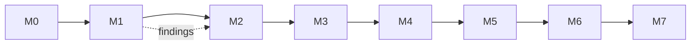

# Roadmap

Delivery plan for the harness described in [architecture.md](architecture.md). The pilot codebase is
the Java application in [code-migration-hackathon](https://github.com/martins-vds/code-migration-hackathon),
the app PR #6 was built for, migrating Java → Python/Django.

| Milestone | Scope | Done when |
|-----------|-------|-----------|
| **M0 · Design** | Architecture, ADRs 0001–0014, glossary, this roadmap | Merged to `main` ✅ |
| **M1 · Spikes** | (a) Run Understand Anything (`/understand`, `/understand-domain`) on the pilot source; confirm the node/edge types the ledger needs appear (endpoints, screens, tables, flows, `tested_by`) and measure time and cost. (b) Assign a test issue to the Copilot coding agent with a custom agent and a read-only source checkout in setup steps. (c) Run CRAP and PIT mutation testing on the pilot source and a Python target stub. | Findings recorded in `docs/spikes/`; architecture amended if anything contradicts it |
| **M2 · Harness skeleton** | Repo layout; JSON Schemas for `profile.yaml`, `capabilities.yaml` and ledger entries; evaluate and pin the built-in skill menu (mattpocock/skills, hackathon-sourced skills, ciembor/agent-rules-books candidates), confirm each license allows redistribution, and resolve overlaps (e.g. `architecture-patterns` vs ciembor's architecture rules); vendor `afs-` copies of user-invoked skills | Schemas validate sample files in CI; menu pinned |
| **M3 · Role agents** | The ten role agents as `.agent.md` files, generalized from PR #6, plus harness skills (migration contract, ledger/evidence writers, quirk ticket, lessons learned) | Agent files reviewed; each has a return contract |
| **M4 · Bootstrap + reference profile** | Bootstrap with the capability checklist and gap tickets; Java → Django reference profile reusing PR #6's stack skills | Bootstrap opens a valid setup PR on a fresh target repo; any gaps appear as operator tickets |
| **M5 · Pilot slice** | One vertical slice of the pilot app through every phase: graph, risk map, characterization, plan, execute, acceptance (all gates + differential check + human side-by-side check) | Slice evidence report green; human check signed off |
| **M6 · Scale test** | Several slices in parallel, local and remote workers mixed, including a data-migration slice | No ledger conflicts; a killed worker is resumed from its ticket alone |
| **M7 · Second language pair** | e.g. C# → Python or .NET Framework → .NET 8 | Pilot slice green with **no changes to role agents**; only a new profile and stack skills |

## Order and dependencies

M1 is deliberately first: its three spikes test the assumptions the rest of the design depends on
(the graph's content, remote dispatch, and CRAP/mutation tooling).
