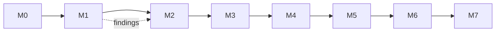

# Roadmap

Delivery plan for the harness described in [architecture.md](architecture.md). M0–M4 used the Java
application in [code-migration-hackathon](https://github.com/martins-vds/code-migration-hackathon)
(private). From M5 the pilot is public: [Eclipse Cargo Tracker](https://github.com/eclipse-ee4j/cargotracker)
(`javaee7` branch, Java EE 7, MIT) → Python/Django, with inputs in
[`examples/cargotracker/`](../examples/cargotracker/). The first M5 run on the private pilot is summarized
in its findings: quirks never block inventory; remote workers need the quirk-file fallback.

| Milestone | Scope | Done when |
|-----------|-------|-----------|
| **M0 · Design** | Architecture, ADRs 0001–0015, glossary, this roadmap | Merged to `main` ✅ |
| **M1 · Spikes** | (a) Run Understand Anything (`/understand`, `/understand-domain`) on the pilot source; confirm the node/edge types the ledger needs appear (endpoints, screens, tables, flows, `tested_by`) and measure time and cost. (b) Assign a test issue to the Copilot coding agent with a custom agent and a read-only source checkout in setup steps. (c) Run CRAP and PIT mutation testing on the pilot source and a Python target stub. (d) Output hygiene: run RTK on the pilot's Maven/pytest output and confirm how its Copilot `preToolUse` hook behaves in the Copilot coding agent (rewrite or deny-with-suggestion). | Done: [findings](spikes/m1/findings.md) (spikes 1–5) ✅ |
| **M2 · Harness skeleton** | Repo layout; the `afs-run` gate wrapper; JSON Schemas for `profile.yaml`, `capabilities.yaml` and ledger entries; evaluate and pin the built-in skill menu (mattpocock/skills, hackathon-sourced skills, ciembor/agent-rules-books candidates), confirm each license allows redistribution, and resolve overlaps (e.g. `architecture-patterns` vs ciembor's architecture rules); vendor `afs-` copies of user-invoked skills | Schemas validate samples in CI; menu pinned in `skills.lock.json`; vendored copies drift-checked ✅ |
| **M3 · Role agents** | The ten role agents as `.agent.md` files, generalized from PR #6, plus harness skills (migration contract, ledger/evidence writers, quirk ticket, lessons learned) | All ten agents with return contracts; skill lists enforced against `skills.lock.json` by `tests/test_agents.py` ✅ |
| **M4 · Bootstrap + reference profile** | Bootstrap with the capability checklist and gap tickets; Java → Django reference profile reusing PR #6's stack skills | Done: `tools/bootstrap.py` + `stacks/java-to-django.json`; pilot [setup PR](https://github.com/martins-vds/ai-factory-pilot-target/pull/6) with the data-migration gap as [#5](https://github.com/martins-vds/ai-factory-pilot-target/issues/5) ✅ |
| **M5 · Pilot slice** | One vertical slice of the pilot app through every phase: graph, risk map, characterization, plan, execute, acceptance (all gates + differential check + human side-by-side check) | Slice evidence report green; human check signed off |
| **M6 · Scale test** | Several slices in parallel, local and remote workers mixed, including a data-migration slice | No ledger conflicts; a killed worker is resumed from its ticket alone |
| **M7 · Second language pair** | e.g. C# → Python or .NET Framework → .NET 8 | Pilot slice green with **no changes to role agents**; only a new profile and stack skills |

## Order and dependencies

M1 is deliberately first: its three spikes test the assumptions the rest of the design depends on
(the graph's content, remote dispatch, and CRAP/mutation tooling).
